

# kigit

### Visual diffs for KiCad PCBs and schematics, straight from git.

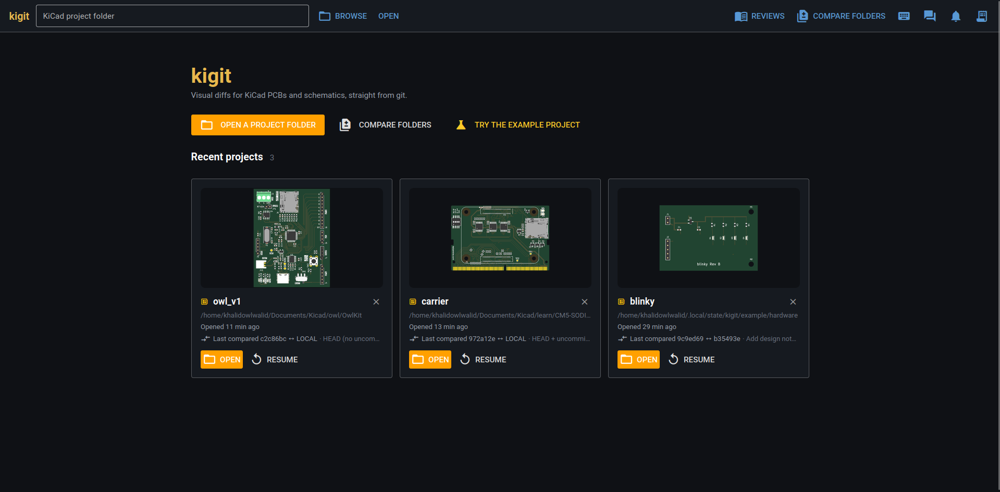

**kigit** utilizes the use of git logs in order to allow user to perform diffs between their pcb and schematic files. It provides a proper visual feedback which helps in identifying changes made per commit basis. Hence where its name came from, combination of Ki from KiCAD and git itself (kigit!). 

What it can do:

- Compare your PCB between any two commits, visually
- Show what changed on your symbols and their fields
- Show your buses and where they're routed
- Works without git too: just point it at two folders
- Keep notes and PR-style discussions on why the board changed, and see any commit in 3D
- A bill of materials: part numbers, stock and prices from Mouser and Digi-Key, carts, your inventory, and builds you assemble board by board
- Comes with an example project to try it all on: `kigit example`

Have a look at the demo below to get a feel for it.

## Demonstration

https://github.com/user-attachments/assets/f906914c-ffff-49df-a43d-28ec8a625058

Full documentation can be found here: https://khalidowlwalid.github.io/kigit/

### PCB diff
Hover a trace to light up its whole net and see what was added, removed or changed.

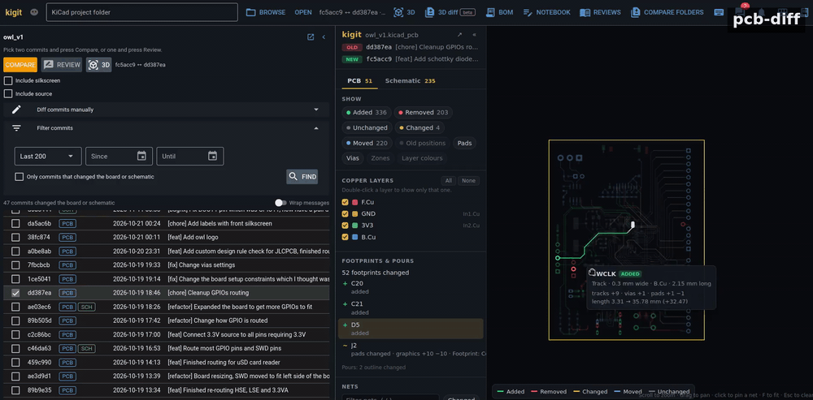

### Schematic diff
Every sheet, with nets computed the way KiCad's netlist does: hover a net, part or bus to see what changed.

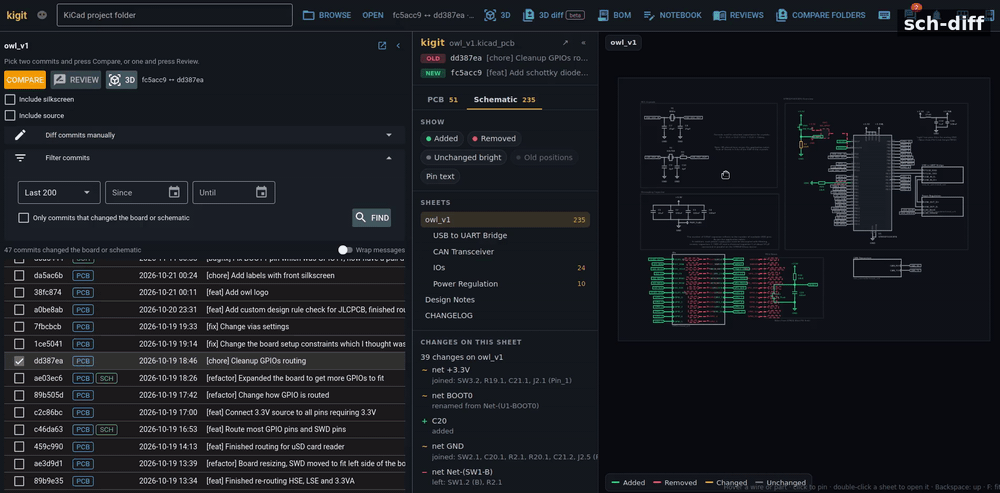

### 3D Viewer
Kigit uses kicad-cli backend to render the PCB and displays the 2 commit's board side by side for ease of comparison

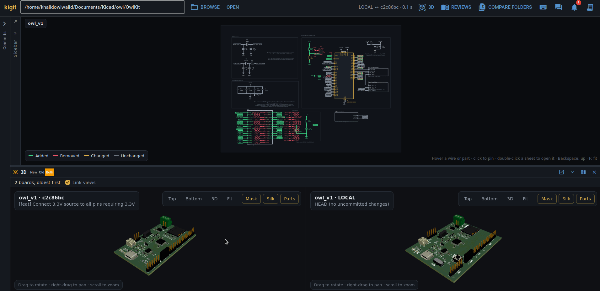

<i>The GUI: pick two commits, see what changed on the schematic and PCB, with both boards in 3D (made by KiCad) docked below, views linked.</i>

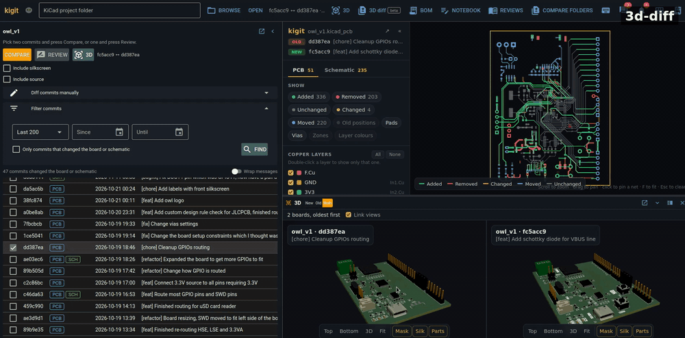

<i>Both commits' boards in 3D, side by side, with their views linked.</i>

### 3D diff (beta)
The comparison's changes on the board in 3D, in a tab of its own: parts added, changed, moved and removed, and the tracks that changed.

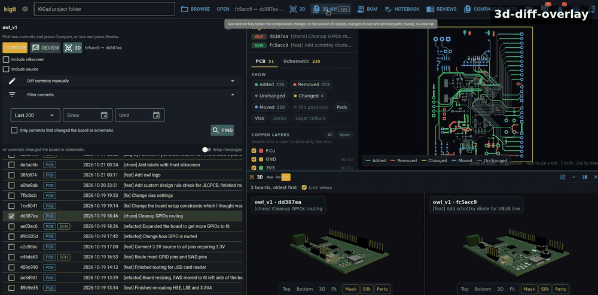

### Reviews and discussions
Review a commit with notes pinned to the parts and nets they're about, and ask for attention with PR-style discussions, all kept as Markdown in your project.

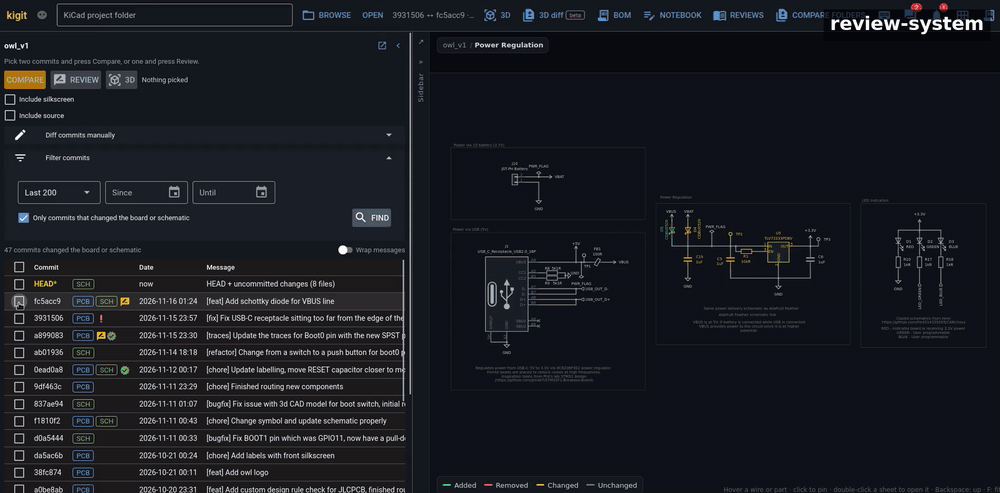

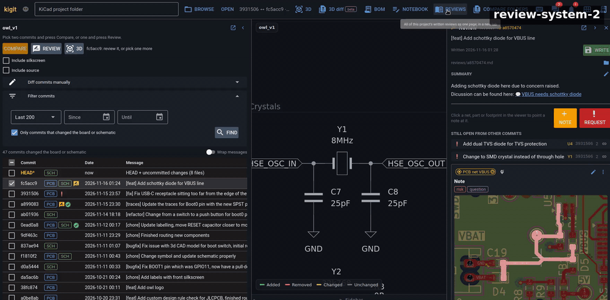

### Activity
A heatmap of your work on the board, day by day: comparisons, reviews, discussions and notes.

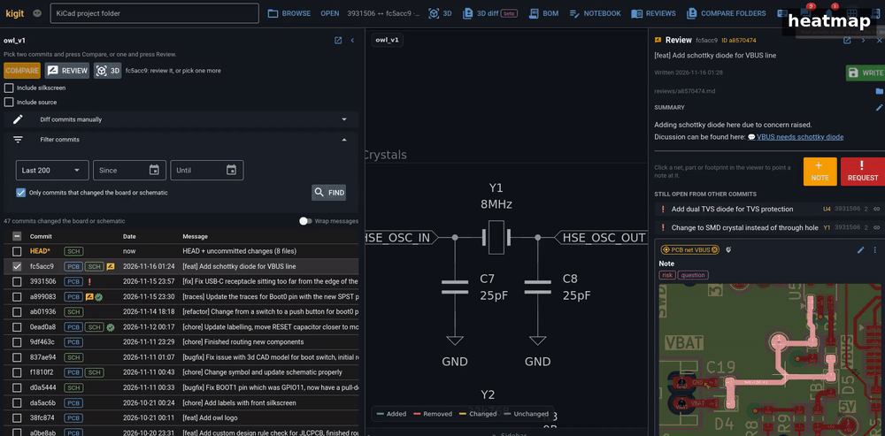

### Bill of materials
The BOM with the board in 2D and 3D beside it: hover a line to light up its parts. Fill in part numbers, look up stock and prices at Mouser and Digi-Key, export carts, track your inventory, and assemble builds board by board.

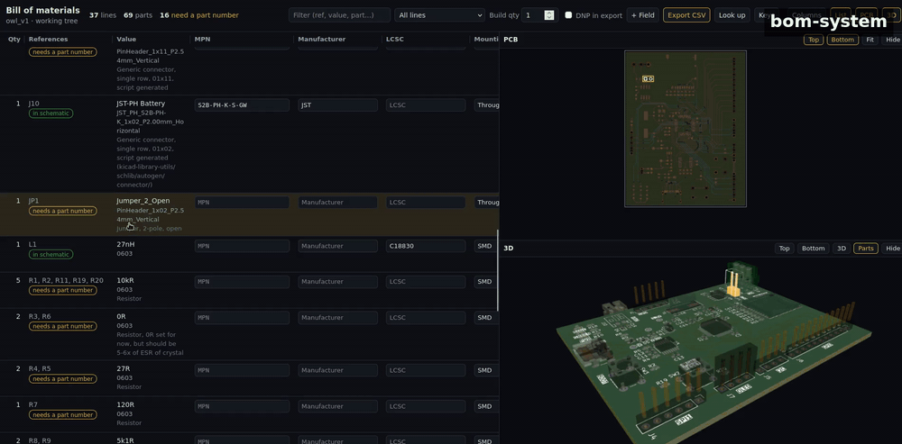

#### Cart assistant
Import your Mouser or LCSC cart into a build: each line shows what's ordered, the board turns green where parts are covered and red where they're short, and rows kigit can't place get a suggested line to accept.

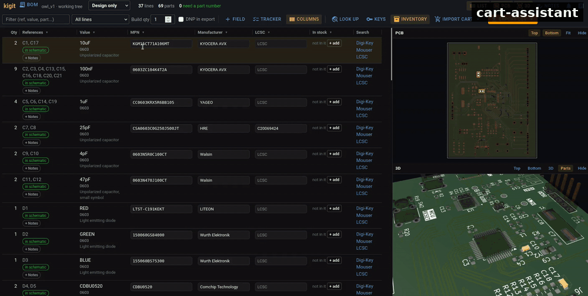

#### Assembly assistant
Assemble a build board by board: tick parts off as you place them (each comes out of your inventory), select several lines at once, and watch the board go from red (still to place) to green (placed).

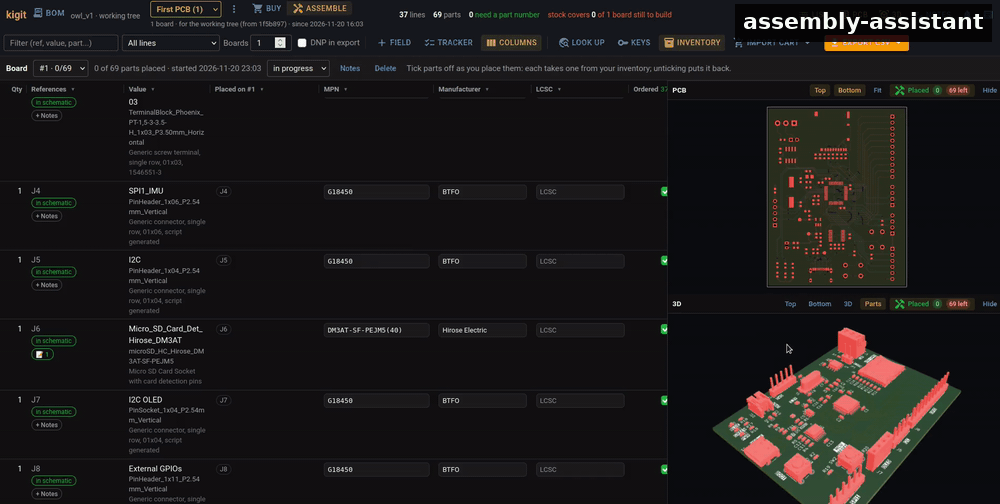

---

## What kigit is not

kigit is an application that was built out of frustration of not having a kind of proper "git diff" for kicad for myself. Having came from a software background and being used to utilizing git versioning for all of my projects, not being able to do the same in a manner that I can compare my pcb and schematic visually between different commits without having to diff the .kicad_pcb and .kicad_sch files really frustates me. I am aware of the fact that there are other resources out there as shown below:

- [KiRI](https://github.com/leoheck/kiri)
- [KiCAD-Prism](https://krishna-swaroop.github.io/KiCAD-Prism/get-started/what-is-prism/)
- [KiHub](https://kihub.dev/)

They all have their pros and cons. KiRI is what got me excited about diffing schematics in the first place, and honestly, huge respect to the folks behind it. It's a great community effort, built well before AI was a thing.

The other two I didn't even know existed when I started. Funnily enough, not even Claude mentioned them when I first went looking for alternatives.

KiCAD-Prism and KiHub are in the same space and cover a lot of what kigit does. KiCAD-Prism is a whole package: free, open source, and the demos look amazing. But it needs a fair bit of Docker setup, which can be a turn-off if you're a hobbyist who just wants to design boards. KiHub needs a login, doesn't run offline, and is really aimed at teams collaborating (PR reviews and that kind of thing).

Me? I'm a hobbyist who only recently got into PCB design and out of this frustration, I figured: why not just make my own PCB diff that does just enough for what I need? Nothing fancy. It runs locally, it's a simple download, and it works on Linux and Windows. (Sorry macOS folks, I'm broke and not about to buy a Mac just for this.)

So, what kigit is **not** is a collaboration tool. It's for people who wants a simple app they can download, or open in a browser, to check what changed in their PCB designs. That's it.

## License

kigit is free and open source under the [MIT License](LICENSE): use it, fork it and change it, in public or private projects, with no need to open-source your own work. Third-party licenses are in [THIRD_PARTY_NOTICES.md](THIRD_PARTY_NOTICES.md).
