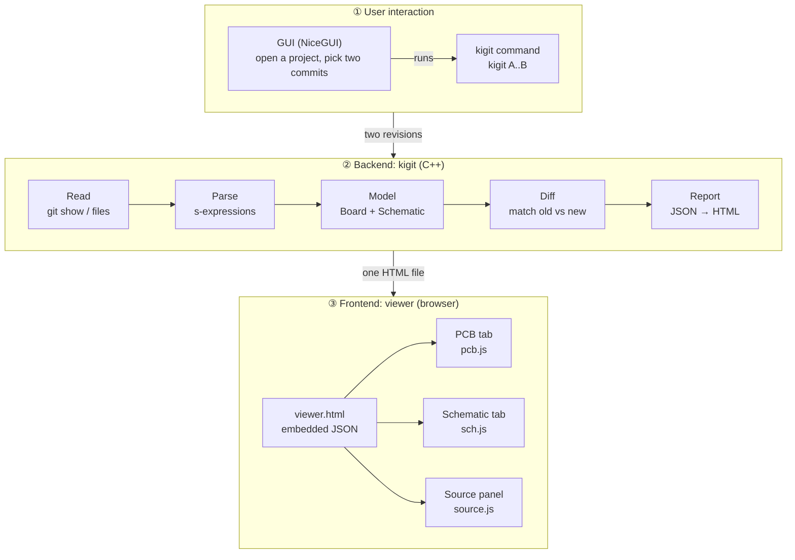

# Architecture

This page is for anyone who wants to read or change kigit's code. It explains how the pieces fit together and where to find things. It doesn't go into every function: for that, the headers in `include/` are short and commented.

## Bird's-eye view

kigit takes two versions of a KiCad project, works out what changed, and writes one HTML page that shows it.

It's built from four parts:

| Part | Language | What it does |
| --- | --- | --- |
| **Core** (`kigit_core`) | C++20 | Reads, parses, matches and diffs the files, and builds the data for the page |
| **Command line** (`kigit`) | C++20 | Parses options, runs the core, prints the summary, writes the page |
| **Viewer** (`resources/`) | HTML + JS | Draws the board and schematic in the browser from that data |
| **GUI** (`gui/`) | Python (NiceGUI) | A front end that calls the `kigit` command line |

The core never draws anything, and the viewer never reads KiCad files. They only meet through JSON.

## The pipeline

Every comparison runs the same steps:



The backend also prints a summary to the terminal straight from the diff, and the GUI shows the finished page in its own window. In the viewer, hovering, pinning and zooming all happen in the browser: nothing goes back to the backend.

| Layer | What it is | Where |
| --- | --- | --- |
| **① User interaction** | How you ask for a comparison: a `kigit` command, or the GUI, which runs that same command for you | `src/commands/`, `gui/` |
| **② Backend** | Everything that touches KiCad files: read, parse, model, diff, and write the page. Never draws anything | `src/git/`, `src/utils/`, `src/pcb/`, `src/sch/`, `src/report/` |
| **③ Frontend** | The page in the browser: draws the board and schematic from the JSON and handles hover, pinning and zoom. Never reads KiCad files | `resources/` |

The backend's steps in more detail:

| Step | What happens | Where |
| --- | --- | --- |
| 1. Read | `git show <rev>:<path>` for the board and every schematic sheet, or the file on disk for `LOCAL` / `--files`. If the board moved in history, it finds the most similar board in that revision. | `git/git.cpp`, `git/locate.cpp` |
| 2. Parse | The text becomes a tree of `Node`s (lists and atoms). The parser knows nothing about KiCad; it also records each list's byte span in the file. | `utils/sexpr.cpp` |
| 3. Model | The tree becomes KiCad things: a `Board` (tracks, arcs, vias, pads, footprints, zones) and a `Schematic` (sheets, symbols, wires, labels, buses), whose nets kigit works out itself. | `pcb/board.cpp`, `sch/schematic.cpp` |
| 4. Diff | Old and new are matched (by KiCad ID, then by geometry) and every item gets a status. Totals are summed per net. | `pcb/diff.cpp`, `sch/sch_diff.cpp` |
| 5. Report | The diff becomes JSON for the viewer, plus the old and new text of changed items with `--source`. | `report/html.cpp`, `report/source.cpp` |
| 6. Page | The JSON is put into the viewer template, which is compiled into the binary, and written as one file. | `report/html.cpp` (`render_html`) |
| 7. Draw | The browser runs the page's JS, which draws SVG from the JSON. | `resources/*.js` |

The terminal summary (the nets table, the schematic changes) is printed from the diff in step 4, not from the JSON. With `--json`, steps 6 and 7 are skipped and the JSON is written instead.

The node trees and how they become `Board` and `Schematic` are shown in detail under [From nodes to structs](#from-nodes-to-structs).

### Nodes

The parser only knows two shapes of node, and every KiCad file is built from them:

| Shape | Looks like | In `Node` |
| --- | --- | --- |
| **List** | `(width 0.25)`, `(segment ...)` | `is_list = true`; `name()` is its first atom (`"width"`), `children` holds the rest |
| **Atom** | `width`, `0.25`, `"F.Cu"` | `atom` holds the text; `quoted = true` if it was written in quotes |

So `(layer "F.Cu")` is a list named `layer` with one quoted atom, and `node.arg(0)` returns `F.Cu`. Lists also carry their `span`, so the source panel can show the exact lines later.

### From nodes to structs

The KiCad meaning comes in step 3, where each kind of list is turned into a field of `Board` or `Schematic`:

=== ".kicad_pcb → Board"

    ```mermaid
    flowchart LR
        P0["(kicad_pcb)"]
        P0 --> P1["(segment)"]
        P0 --> P2["(arc)"]
        P0 --> P3["(via)"]
        P0 --> P4["(footprint)"]
        P4 --> P5["(pad)"]
        P4 --> P6["(property)"]
        P4 --> P7["(fp_line) (fp_arc) (fp_rect)<br/>(fp_circle) (fp_poly) (fp_text)"]
        P0 --> P8["(zone)"]
        P8 --> P9["(polygon)"]
        P8 --> P10["(filled_polygon)"]
        P0 --> P11["(gr_line) (gr_arc) (gr_rect)<br/>(gr_circle) (gr_poly) (gr_text)"]
        P0 --> P12["(net)"]

        P1 -.-> I["items"]
        P2 -.-> I
        P3 -.-> I
        P5 -.-> I
        P4 -.-> FP["footprints"]
        P6 -.-> FP
        P7 -.-> SK["silk<br/>(--silkscreen)"]
        P9 -.-> Z["zones"]
        P10 -.-> X["skipped"]
        P11 -.-> O["outline<br/>(Edge.Cuts)"]
        P11 -.-> SK
        P12 -.-> N["net names"]

        classDef field fill:#7e57c2,stroke:#7e57c2,color:#fff
        classDef skip stroke-dasharray:4 3
        class I,FP,SK,Z,O,N field
        class X skip
    ```

    Solid lines are the file's nesting; dotted lines show which `Board` field each node ends up in.

    | Node | Becomes | Notes |
    | --- | --- | --- |
    | `(segment)` | `items`, kind Track | |
    | `(arc)` | `items`, kind Arc | |
    | `(via)` | `items`, kind Via | |
    | `(pad)` inside `(footprint)` | `items`, kind Pad | Position made absolute from the footprint's `(at)` |
    | `(footprint)` | `footprints` | Reference and value from its `(property)` lists; its `fp_*` graphics are compared too |
    | `(zone)` | `zones` | Its `(filled_polygon)` lists are skipped: KiCad recomputes them on every refill |
    | `(gr_*)` on Edge.Cuts | `outline` | The board shape |
    | `(gr_*)` / `(fp_*)` on silkscreen | `silk` | Only with `--silkscreen` |
    | `(net)` | Net names | Older files list nets by number at the top |

=== ".kicad_sch → Schematic"

    ```mermaid
    flowchart LR
        S0["(kicad_sch)"]
        S0 --> S1["(lib_symbols)"]
        S1 --> S2["(symbol)<br/>part definition"]
        S0 --> S3["(symbol)<br/>placed part"]
        S0 --> S4["(wire)"]
        S0 --> S5["(junction)<br/>(no_connect)"]
        S0 --> S6["(label) (global_label)<br/>(hierarchical_label)"]
        S0 --> S7["(bus) (bus_entry)<br/>(bus_alias)"]
        S0 --> S8["(sheet)"]
        S8 --> S9["(pin)"]
        S0 --> S10["(text)"]
        S0 --> S11["(polyline) (rectangle)<br/>(circle) (arc) (bezier)"]

        S2 -.-> D["defs"]
        S3 -.-> SY["symbols"]
        S4 -.-> W["wires"]
        S5 -.-> J["junctions<br/>no_connects"]
        S6 -.-> L["labels"]
        S9 -.-> L
        S7 -.-> B["buses, bus_entries<br/>bus_aliases"]
        S8 -.-> SB["sheet_boxes<br/>+ child sheet loaded"]
        S10 -.-> T["texts"]
        S11 -.-> DR["drawings"]

        classDef field fill:#7e57c2,stroke:#7e57c2,color:#fff
        class D,SY,W,J,L,B,SB,T,DR field
    ```

    Solid lines are the file's nesting; dotted lines show which `Schematic` field each node ends up in.

    | Node | Becomes | Notes |
    | --- | --- | --- |
    | `(lib_symbols)` → `(symbol)` | `defs` | Each part type's pins and drawing, stored in the file |
    | `(symbol)` | `symbols` | A placed part. Power symbols (`+3.3V`, `GND`) are symbols too |
    | `(wire)` | `wires` | |
    | `(junction)`, `(no_connect)` | `junctions`, `no_connects` | |
    | `(label)`, `(global_label)`, `(hierarchical_label)` | `labels` | Their names join nets across wires and sheets |
    | `(bus)`, `(bus_entry)`, `(bus_alias)` | `buses`, `bus_entries`, `bus_aliases` | |
    | `(sheet)` | `sheet_boxes`, and its file is loaded as a new sheet | Through the `FileReader` |
    | `(pin)` inside `(sheet)` | `labels`, kind SheetPin | Connects the parent sheet to the child's hierarchical labels |
    | `(text)` | `texts` | |
    | `(polyline)`, `(rectangle)`, `(circle)`, `(arc)`, `(bezier)` | `drawings` | Drawn only; they don't connect anything |

    After every sheet is loaded, kigit works out `nets` from the wires, labels, pins and buses.

## Code map

Headers live in `include/<dir>/`, and their sources in `src/<dir>/` with the same names.

### `utils/`

The building blocks with no KiCad knowledge.

- **`sexpr`**: the s-expression parser. `sexpr::parse(text)` returns a `Node` tree, with each list's `span` (where it starts and ends in the text).
- **`platform`**: everything that differs between Windows and Linux: running programs, finding them on PATH, opening a browser, home and state folders.
- **`log`**: the session log (spdlog), one file per run.

### `git/`

- **`git`**: a thin wrapper around the `git` command line: resolve a revision, `show` a file at a revision, `log`, list files. kigit runs the real `git` program rather than a library, so it behaves exactly like the user's git.
- **`locate`**: finding the board in a revision when it was moved or renamed (`find_similar_board`), by comparing footprints and nets.

### `pcb/`

- **`board`**: `load_board(text)` turns a `.kicad_pcb` into a `Board`. Tracks, arcs, vias and pads are all one `Item` type with a `kind`, because the diff treats them the same way.
- **`diff`**: `diff_boards(old, new)` matches items and footprints and returns a `Diff`: each item with its status, plus per-net and per-footprint totals.

### `sch/`

- **`schematic`**: `load_schematic(root_file, reader)` loads a schematic and all its sheets, then works out the nets: which pins each wire, label, power symbol and bus connects. It reads sheets through a `FileReader` function, not from disk, so the same code works for a git revision, the working tree, or a folder.
- **`sch_diff`**: `diff_schematics(old, new)` matches parts (by KiCad ID, then reference) and nets (by label, then shared pins), and sorts each change into electrical, fields only or cosmetic.
- **`netcheck`**: `--check-netlist`, which compares kigit's nets with a netlist exported by KiCad. This is how the net logic is tested against KiCad itself.

### `report/`

- **`html`**: turns boards, schematics and diffs into the viewer's JSON (`report_data`, `schematic_view_json`), and `render_html` puts that JSON into the page template.
- **`source`**: the text snippets for the source panel. `SourceFile` turns a `Span` into whole lines with line numbers; `SourceTable` collects one entry per changed item.

### `commands/`

The command line, one file per command, in namespace `kigit::cmd`. Only the `kigit` executable has these; they aren't part of `kigit_core`.

| File | Command |
| --- | --- |
| `options` | Parsing the command line and `--help` |
| `diff` | The main job: steps 1 to 6 above, plus `--check-netlist` |
| `summary` | The tables printed to the terminal |
| `history` | `--log`: the commit list for the GUI |
| `projects` | `--projects`: KiCad projects in a folder, for the GUI |
| `gui` | `kigit gui`: finds uv and starts the Python app |
| `common` | Helpers they share, like finding the project folder |

`src/main.cpp` starts the log, then picks the command.

### `resources/` (the viewer)

| File | What it does |
| --- | --- |
| `viewer.html` | The page shell: layout, styles, and slots for the data and scripts |
| `pcb.js` | The PCB tab: drawing, hover, pinning, the net list |
| `sch.js` | The schematic tab: sheets, parts, wires, nets |
| `source.js` | The source panel: the side-by-side text diff (line diff done in JS) |
| `shell.js` | The tabs and everything shared between them |

At build time, CMake puts the four scripts into `viewer.html` and compiles the result into the binary as a byte array. At run time, `render_html` replaces the `/*KIGIT_DATA*/` slot with the JSON. That's why the output is a single file with no dependencies.

### `gui/`

A NiceGUI app (`gui/kigit_gui/`). It doesn't link to the core: it runs the `kigit` command line (`kigit.py`) and uses its JSON output (`--projects`, `--log`, `--json`) or its page (`-o -`).

- `app.py`: the screens (open a project, pick commits, compare).
- `kigit.py`: calling the `kigit` binary.
- `folder_picker.py`, `logs.py`: the folder dialog and the log view.

`kigit gui` starts it with uv, which sets up the Python environment on first run.

## Rules that hold everywhere

These are worth keeping when you change things.

- **The core doesn't draw, and the viewer doesn't parse.** All drawing is in `resources/*.js`; all KiCad file reading is in C++. They only share JSON.
- **The parser knows nothing about KiCad.** `sexpr` returns lists and atoms. Meaning (what a `segment` is) belongs in `pcb/` and `sch/`.
- **OS-specific code lives in `utils/platform` only.** Everything else is plain C++ and builds the same on Windows and Linux.
- **git is only used through `git/`.** Nothing else runs git.
- **Schematics are read through a `FileReader`.** That keeps the loader independent of where the files come from.
- **stdout stays clean.** With `-o -` the page or JSON goes to stdout, so messages go to stderr or the log.
- **The page is one self-contained file.** No server, no external scripts. It must open from disk, years later.
- **Big extras are opt-in.** Silkscreen (`--silkscreen`) and the source panel (`--source`) make pages bigger, so they're off by default.

## Build and dependencies

- **CMake** builds `kigit_core` (a static library with everything except the command line) and the `kigit` executable. Tests link `kigit_core` directly.
- **Libraries** are git submodules in `submodules/`: nlohmann_json (JSON), spdlog (logging), doctest (tests).
- **CI** (GitHub Actions) builds and tests on Windows (MSVC) and Linux (GCC) on every push. Tagged releases build the Windows installer, the Windows zip and the Linux tarball.

## Where to start

| You want to... | Look at |
| --- | --- |
| Support a new KiCad item on the board | `pcb/board.cpp` (load it), `pcb/diff.cpp` (match it), `report/html.cpp` (send it), `resources/pcb.js` (draw it) |
| Change how items are matched | `pcb/diff.cpp` or `sch/sch_diff.cpp` |
| Fix a schematic net that's wrong | `sch/schematic.cpp`, and test it with `--check-netlist` against KiCad's netlist |
| Change what the terminal prints | `commands/summary.cpp` |
| Add a command-line option | `commands/options.cpp`, then use it in the command |
| Change the look of the viewer | `resources/viewer.html` (styles) and the matching `.js` file |
| Change the GUI | `gui/kigit_gui/app.py` |
