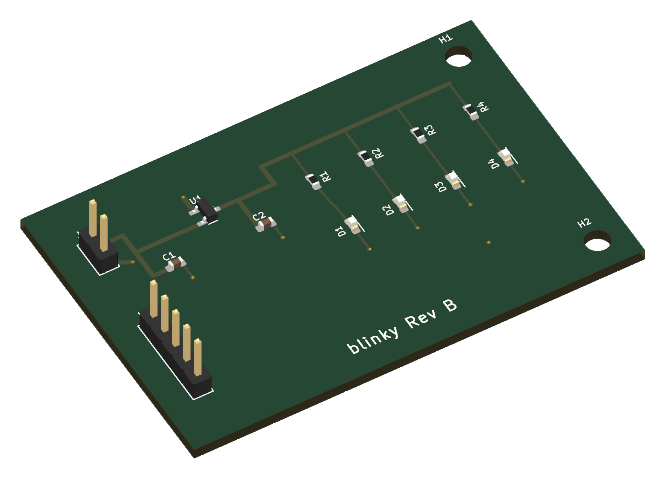

# Try the Example

kigit comes with an example project to play with: **blinky**, a small LED board with a short git history in which every commit changes something different, so each of kigit's features has something to show.

<figure markdown="span">
  { width="560" }
  <figcaption>blinky: power in (J1), a 3.3 V regulator (U1), a header for a microcontroller (J2) and four status LEDs.</figcaption>
</figure>

## Get it

=== "GUI"

    Start `kigit gui` in a folder without a KiCad project (or click **kigit** in the header) and press **Try the example project** on the landing page. It's made once, in kigit's [app folder](app-folder.md) (`example/`), and opened; delete that folder to start afresh.

=== "Command line"

    ```sh
    kigit example                 # makes ./kigit-example
    kigit example ~/blinky        # or a folder of your choice
    kigit gui ~/blinky            # then open it
    ```

It's an ordinary git repository and an ordinary KiCad project (KiCad 8 or newer opens it), so you can also change it, commit, and see your own changes.

## What's in it

The schematic has a root sheet (power in, the regulator, the header) and a hierarchical **LEDs** sheet joined to the header by a bus, `LED[0..3]`. The board has two copper layers, a ground pour on the back, vias, and KiCad's own 3D models.

The history, oldest first:

| Commit | What changed | Try |
| --- | --- | --- |
| **First board** | Power in, regulator, two LEDs | — |
| **Add two more LEDs** | R3, R4, D3, D4 and their tracks added; J2 grows from 3 to 5 pins (another footprint); the bus widens | Compare it with the first: added parts and tracks in green, J2 "changed" with its footprint and pins; on the schematic, the new nets |
| **Rework the power** | U1 moved, power tracks wider, a via moved and one added, the ground pour's outline changed, C2 10u → 22u, R1 1k → 470, silkscreen "Rev A" → "Rev B" | Compare it with the one before: U1 **moved** (blue, not removed and added), the wider tracks "changed", the pour outline; values on both tabs; tick **Include silkscreen** to see Rev B |
| **Rename VIN, share an LED line** | Net VIN renamed VBUS; D4 moved from LED3 to LED2; test point TP1 and its track removed | The schematic's net list: VBUS "renamed from /VIN", D4's pin on another net, TP1 removed |
| **Move the project** | Everything moves from `board/` into `hardware/` | Compare anything across it: kigit finds the board in its old folder and says so |
| **Design notes** | Reviews and discussions in `reviews/` | The :material-comment-edit: marks in the commit list, **Reviews** and **Discussions** in the header |
| *(uncommitted)* | R2 1k → 680, D1 nudged | The top entry, your working tree: compare it with HEAD |

## Things to try

1. **Compare** "Add two more LEDs" with "First board": the [PCB](how-to-use/pcb-viewer.md) and [schematic](how-to-use/schematic-viewer.md) diff. Hover a trace to light up its net; click D3 in the footprint list.
2. **Review** "Rework the power": its review opens with three notes. Click a note's chip to show U1 or C2 in the viewer.
3. **Discussions** in the header: one is done and waits to be accepted (TP1), one needs attention (D4 sharing LED2). Click a commit hash in TP1's discussion to compare where it was opened with that commit: TP1 shows as removed, at the place it was. Reply, mark done, accept: see [Reviews](how-to-use/reviews.md#discussions-asking-for-attention).
4. **3D**: pick one commit and press 3D; pick two for side by side; turn **Mask** off to follow the tracks. See [3D View](how-to-use/3d-view.md).
5. **Reviews** in the header: the reviews site. The Reviews tab is the timeline, the **decisions** tab has a design decision written as a plain Markdown note, and the search box finds anything (try "regulator").
6. **Wrap messages**, **Filter commits** ("only commits that changed the board or schematic" skips the design-notes commit), and **?** for every shortcut.

From the command line:

```sh
cd kigit-example/hardware
kigit HEAD~4..HEAD~3          # the power rework, with a summary in the terminal
kigit --source HEAD~3..HEAD~2 # with the source panel: the KiCad file text behind each change
kigit                         # HEAD vs your uncommitted change
```
