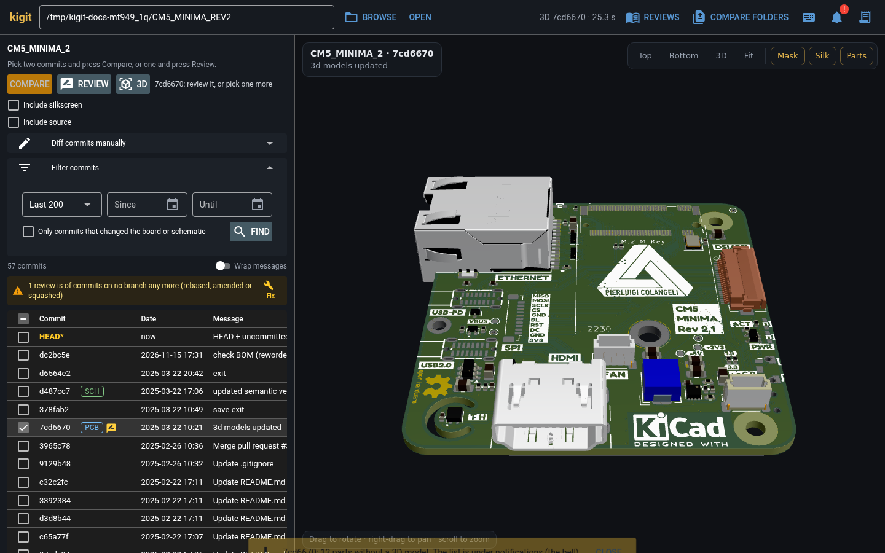
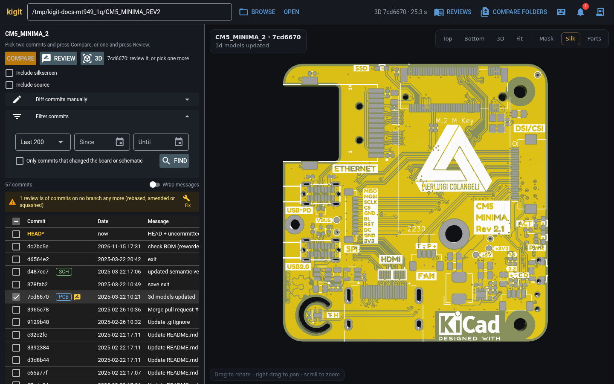
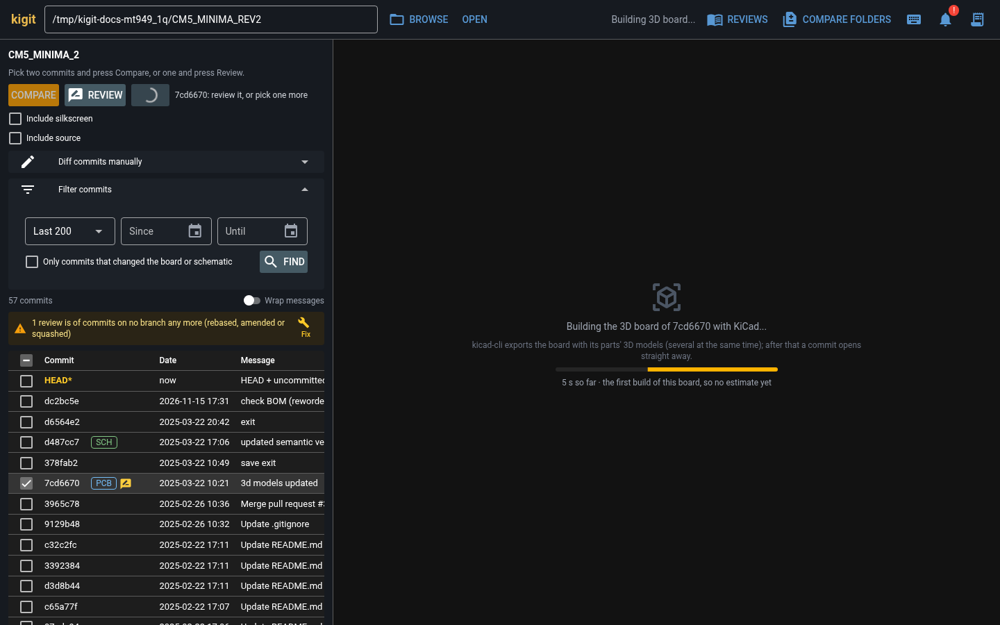
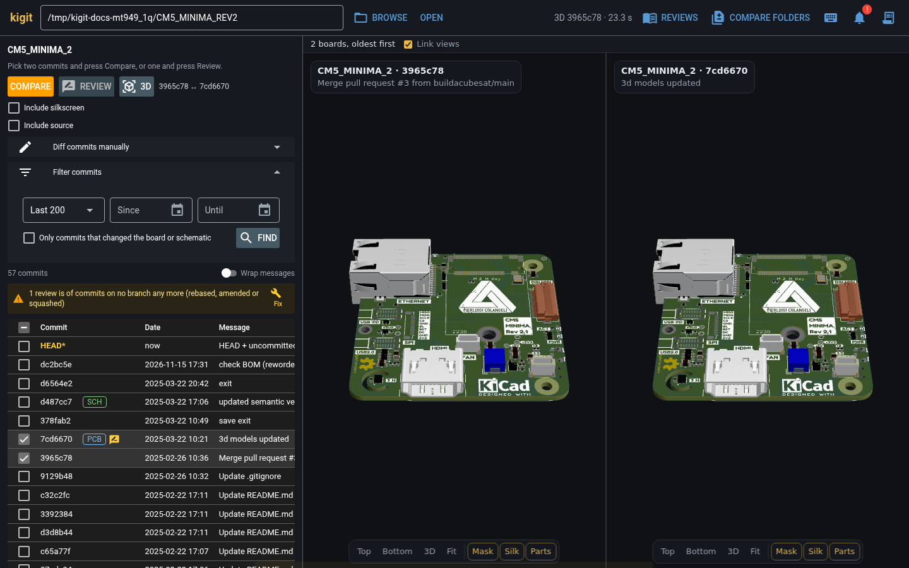
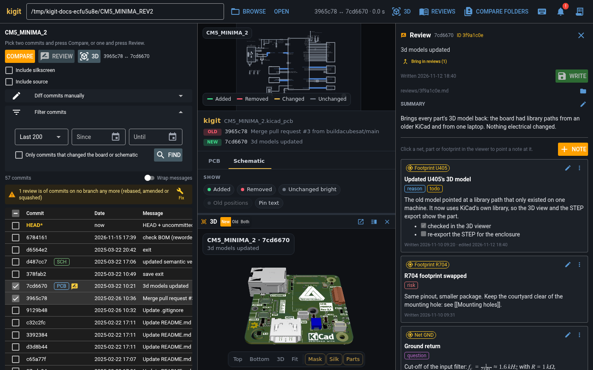
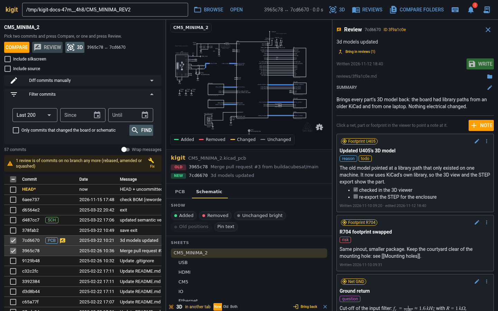
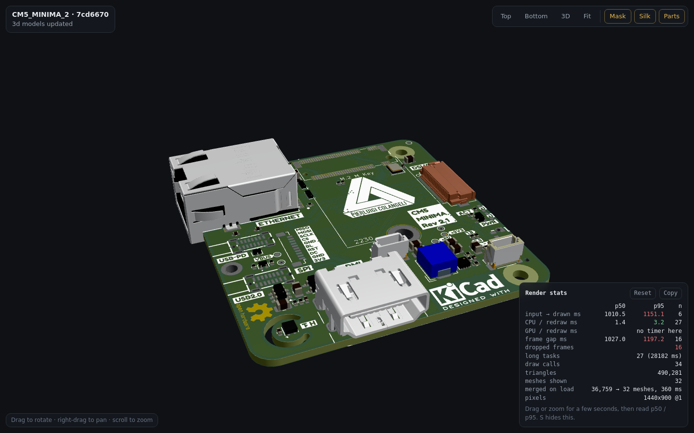

# 3D View

See a commit's board in 3D, the way KiCad draws it: copper, pads, silkscreen, solder mask and the parts' 3D models. It isn't a comparison, just how the board looked then. Put several commits side by side, or dock it beside a comparison.

!!! note "Needs KiCad 8 or newer"
    KiCad makes the 3D model (`kicad-cli pcb export glb`); kigit only shows it. kigit finds `kicad-cli` on your PATH or where the KiCad installer puts it; if it's somewhere else, set `KIGIT_KICAD_CLI` to its path.

## One commit

In the [GUI](gui.md), pick **one** commit (or the working tree at the top) and press **3D**.

<figure markdown="span">
  
</figure>

- Drag to rotate, right-drag (or ++shift++-drag) to pan, scroll to zoom.
- **Top**, **Bottom** and **3D** jump to those views, **Fit** brings the whole board back into view.
- **Parts**, **Mask** and **Silk** hide or show the parts, the solder mask and the silkscreen.

### Following traces

Under the solder mask, traces are faint, in KiCad's own 3D viewer too. Turn **Mask** off (++m++) and the copper lies bare, so every trace is easy to follow, with its clearance around it:

<figure markdown="span">
  
  <figcaption>Top view with the mask and parts off: the copper itself.</figcaption>
</figure>

### Making the model

The first time you open a commit in 3D, KiCad makes its model: a few seconds for a small board, about half a minute for a big one. After that, the same commit opens straight away for the rest of the session.

<figure markdown="span">
  
  <figcaption>KiCad doesn't report its progress, so the bar is the time against this board's last build.</figcaption>
</figure>

Those times are kept in `3d-build-times.json` in kigit's [app folder](../app-folder.md); the very first build of a board just counts the seconds.

kigit takes the board, its project file and any 3D model files in the repository out of that commit, so footprints that point at models with `${KIPRJMOD}` find them. A board saved by an older KiCad points at that version's library (`${KICAD8_3DMODEL_DIR}/...wrl`); kigit points those at your KiCad's library (and at the `.step` models from KiCad 10 on, which has no `.wrl`), so they show too.

Parts whose model file can't be found at all, such as an absolute path on someone else's computer, are left out. The [notifications](gui.md#notifications) list them, with the file KiCad looked for.

## Side by side

Pick **up to four** commits and press **3D** to see their boards side by side, oldest first. Turn, zoom or pan one and the others follow, so you see each board from the same angle; hiding the mask or the parts on one hides it on all. **Link views** at the top (or ++l++) turns that off.

<figure markdown="span">
  
</figure>

Their models are made at the same time.

## Beside a comparison

While comparing two commits, press **3D** in the header to dock the board in 3D next to the diff, so you can look at both. **New**, **Old** or **Both** (side by side, views linked) picks which.

<figure markdown="span">
  
  <figcaption>The 3D dock. When the commit list and the review panel are open too, it goes below the comparison.</figcaption>
</figure>

- Drag the divider to resize it; double-click it to reset.
- :material-view-split-horizontal: puts it **below** the comparison instead of beside it, or back. The first time, kigit picks whichever leaves the comparison more room; after that it remembers.
- :material-open-in-new: opens it in a **browser tab of its own** (to put on another screen, say). The dock shrinks to a bar under the comparison, where New, Old and Both still choose what that tab shows. Close the tab, or press **Bring back**, and it's docked again where it was. If nothing opens, allow pop-ups for the kigit page.

<figure markdown="span">
  
  <figcaption>In another tab: only the dock's bar stays, at the bottom.</figcaption>
</figure>

## If it feels slow

Press ++s++ in the 3D view for render stats: how long after your input a frame is drawn, how long each redraw takes (CPU, and GPU where the browser can time it), the gaps between frames while you drag, dropped frames, draw calls and triangles, each as p50 / p95. **Copy** puts them on the clipboard as JSON, handy for a bug report.

<figure markdown="span">
  
  <figcaption>Render stats. (This one ran without a GPU, so its times are high.)</figcaption>
</figure>

KiCad exports a board as tens of thousands of small pieces; kigit merges them into a few dozen when it loads ("merged on load"), so even big boards turn smoothly. Hiding the parts makes it lighter still.

## From the command line

```sh
kigit --3d HEAD~1 -o board.glb   # the board at HEAD~1 as a 3D model (binary glTF)
kigit --3d -o board.glb          # the working tree
```

The `.glb` opens in most 3D tools (Blender, online glTF viewers).
