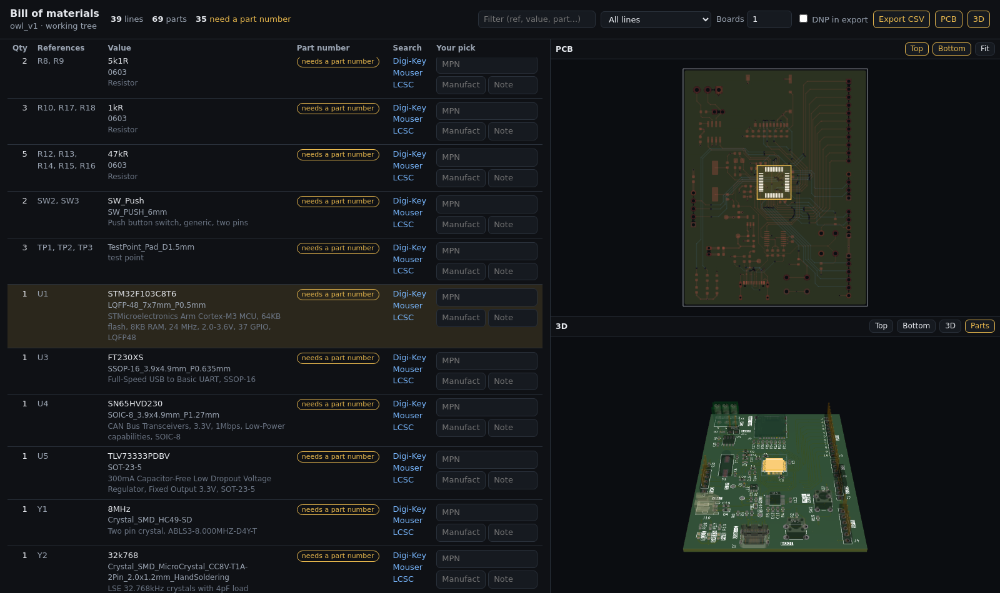
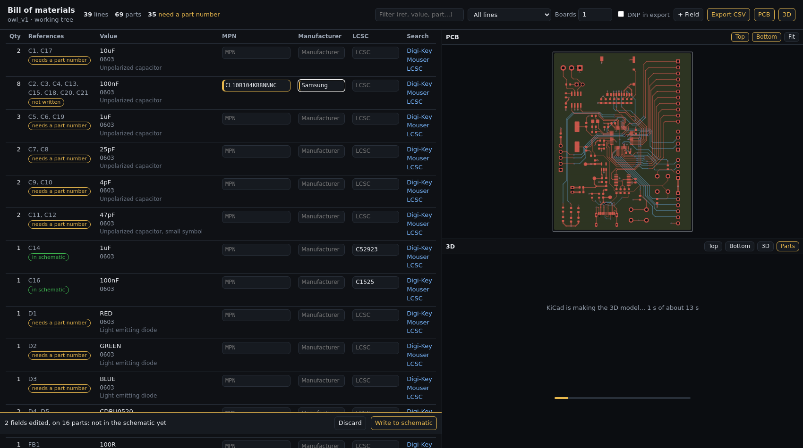

# Bill of Materials

kigit makes your board's bill of materials when you ask for it: in the GUI with **BOM** in the header, or with `kigit bom` on the command line. Nothing runs in the background.

<figure markdown="span">
  
  <figcaption>The BOM page with U1 hovered: lit on the board in 2D and in 3D.</figcaption>
</figure>

## The board beside the list

On the right, the board twice: **PCB** (drawn from the board file itself: outline, copper on each layer, pours, tracks, vias and pads) and **3D** (the same model as the 3D view).

- **Hover a line**: its parts light up on both, with a box around each, and the rest fades.
- **Hover a part** on either: its line lights up (the list scrolls to it), with a tooltip saying what it is.
- **Click a line** to keep its parts lit while you look around (click again to let go); the PCB zooms to them if they're off screen.
- PCB: scroll to zoom, drag to pan, **Top** / **Bottom** show or hide each side, **Fit**. 3D: drag to turn, as in the 3D view.
- **PCB** and **3D** in the header hide either pane (remembered).

The PCB shows straight away. KiCad makes the 3D model after the page opens (seconds on a small board, a minute or more on a big one; a board already made is reused), with its progress in the pane. Without KiCad, the 3D pane says so and the rest works.

## What's on a line

Parts with the same value, footprint, part numbers and DNP state share a line, with their quantity and references (in order: R2 before R10). Left out: power symbols, `#` references and parts marked *Exclude from bill of materials*. A part in several units (U1A, U1B) counts once.

Part numbers are read from the fields most people use, whatever the spelling: `MPN` (or `Manufacturer Part Number`, `MFR PN`...), `Manufacturer`, `DigiKey`, `Mouser` and `LCSC` (`LCSC Part #`...). Do-not-populate parts are those with KiCad's DNP flag, a `DNP` field, or the value `DNP` (as older projects did).

## Finding parts

Each line has **Digi-Key**, **Mouser** and **LCSC** links that open the site's search for:

- the line's own part number at that site, or its MPN;
- otherwise, for chip resistors, capacitors, inductors, ferrites and LEDs, the value and package: "10k 0603 resistor" (`10kR`, `5k1` and `4R7` are written the way distributors search: `10k`, `5.1k`, `4.7 ohm`);
- otherwise the value, which for an IC is usually its part name.

The links only open the sites in your browser: kigit itself doesn't contact anyone. A part number you've typed in (not written yet) searches for itself.

## Editing part numbers

The BOM is also where part numbers go into your schematic, without hunting for parts in KiCad: hover a line and you see exactly which parts it is, on the board, while you type.

<figure markdown="span">
  
  <figcaption>MPN and manufacturer typed in for the 100nF line: marked, and counted in the bar at the bottom until written.</figcaption>
</figure>

- The columns are **MPN** and **Manufacturer**, **Digi-Key**, **Mouser** and **LCSC** when your project uses them, and any field you add with **+ Field** (Supplier, Tolerance...). Each uses the name your project already uses for it ("LCSC Part #", "Part Number"...), so nothing ends up under two names.
- Type in a cell: it's a **draft** (marked), saved as you type in `kigit-bom.json` next to the board (commit it to share drafts). A line's value applies to every part on it.
- **Write to schematic** puts the drafts into the schematic files; **Discard** drops them; **Undo** puts the files back as they were before the last write.

kigit is not a schematic editor, and this can't change your design:

- It only writes **part information fields**. KiCad's own fields (Reference, Value, Footprint, Datasheet, Description, and its internal ones) are refused, and it never touches the board file, the wiring or anything else.
- Each field is the smallest change to the file: an existing value replaced in place, or a new field copied from the part's own hidden Footprint field (so it's hidden too, in your file's KiCad format, KiCad 6 to 10). The rest of the file stays byte for byte, so `git diff` shows only those lines.
- Before saving, kigit reads the edited schematic back and checks it's the **same design**: every net, wire, label and part (reference, value, footprint, position) unchanged, and the fields read back as written. If anything differs, nothing is written.
- If KiCad has the schematic open, kigit says so first: save there, or write anyway and let KiCad reload it.
- The files it replaced are kept in `.kigit/bom-backup/` next to the schematic (not in git), which is what **Undo** uses.

Only the working tree can be edited: a commit's BOM is read-only.

## Exporting

**Export CSV** writes a file for Digi-Key's BOM Manager or Mouser's BOM Tool (both let you match up the columns): quantity, manufacturer, MPN, Digi-Key, Mouser and LCSC part numbers, references, value, footprint, and fields you added. It uses what's on screen, drafts included. **Boards** multiplies the quantities; DNP parts are left out unless you tick **DNP in export**.

## Which revision

The working tree by default (the files on disk, saved or not committed). Tick one commit in the commit list first to get that commit's BOM instead.

## From the command line

```sh
kigit bom                      # the project in this folder, as a table
kigit bom HEAD~3               # at a commit
kigit bom --csv -o bom.csv     # CSV
kigit bom --json               # everything, with the search links
kigit bom path/to/x.kicad_sch  # a schematic, .kicad_pro, .kicad_pcb or folder
kigit bom --write edits.json   # set part information fields (see below)
kigit bom --restore .kigit/bom-backup/20261118-204925-877   # undo a --write
```

`--write` takes a list of `{"refs": ["R1", "R2"], "field": "MPN", "value": "RC0603FR-0710KL"}` (or `-` to read it from stdin), with the same rules and checks as the page, and prints what it wrote and where the backup is. `--force` writes even when KiCad has the schematic open.

Without git it reads the files on disk; a revision then is an error.
