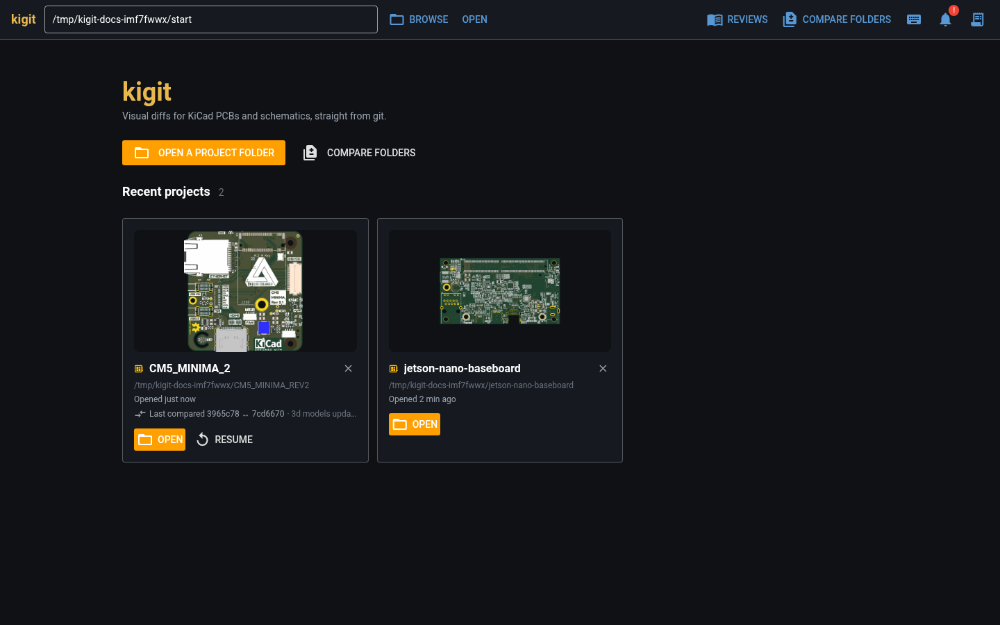
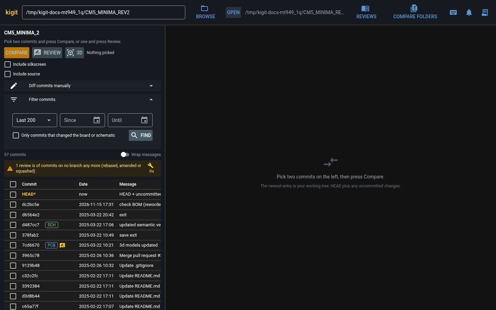
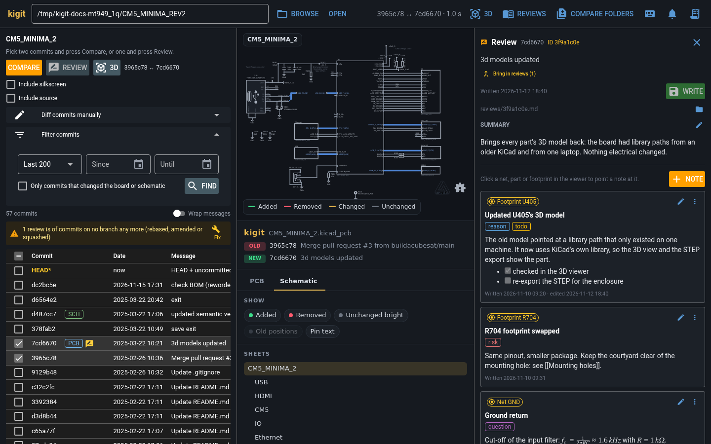
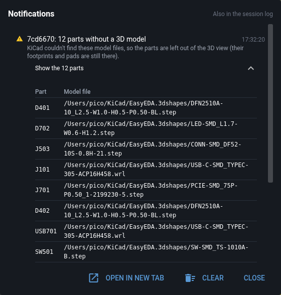
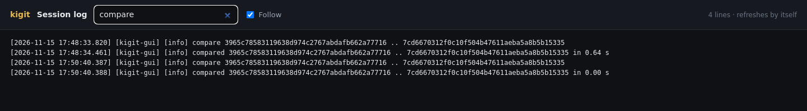
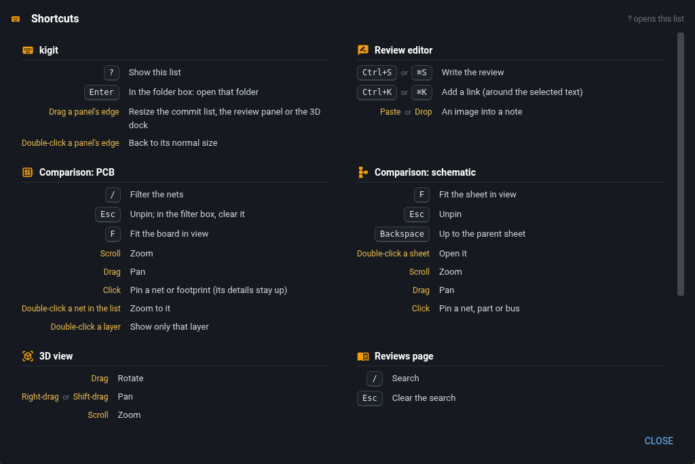

# GUI

```sh
kigit gui                  # start in the current folder
kigit gui ~/path/to/board  # or any folder
kigit gui --port 9000      # on a port of your choice
```

The GUI opens in your web browser, on Windows and Linux alike. `kigit gui --native` opens it in its own window instead (Edge WebView2 on Windows); if a window can't be opened, it says why and uses the browser. It only listens on 127.0.0.1, so it isn't reachable from the network.

It serves on port 8765, or the next free one when another kigit GUI already has it, so you can run several at once (say, one per project); the address it uses is printed when it starts. `--port N` picks the port yourself, and stops with a message if it's taken. Panel widths and other display settings are remembered per port.

This page covers opening a project and comparing commits. [Reviews](reviews.md) and the [3D view](3d-view.md) have pages of their own.

## Landing page

When `kigit gui` starts in a folder without a KiCad project to open (say, your home folder), it opens on a landing page with your recent projects. Click **kigit** in the header to come back to it any time.

<figure markdown="span">
  
  <figcaption>Recent projects, newest first. Resume compares the last two commits you looked at again.</figcaption>
</figure>

Each card shows:

- **A picture of the board**, rendered by KiCad (`kicad-cli pcb render`, a few seconds, in the background) when you open the project, and again once the board file has changed. KiCad 8 has no 3D render, so with it the picture is a 2D drawing of the board's top instead. Without KiCad the card shows an icon.
- **When you last opened it**, and the **last two commits you compared** there.
- **Open** opens the project; **Resume** opens it and compares those commits again; the cross takes it off the list (the project itself is untouched). A project whose folder has gone is shown greyed out.

The list is kept in `sessions.json` in kigit's [app folder](../app-folder.md), with the pictures in `thumbnails/` next to it; every `kigit gui` you run shares it.

## 1. Open a project

Type a folder or press **Browse** (folders holding KiCad files are marked). kigit looks for a project in that folder and up to two levels below. It tells you if it finds none, if the project has no `.kicad_pcb`, or if it isn't in a git repository; if it finds several, it asks which one.

<figure markdown="span">
  
  <figcaption>The commit list: your working tree on top, then every commit, tagged PCB / SCH when it changed the board or schematic.</figcaption>
</figure>

## 2. Pick commits

All commits are listed, newest first, tagged **PCB** / **SCH** when they changed the board or schematic. The top entry is your working tree: HEAD plus any uncommitted changes. Hover a message to read all of it, or turn on **Wrap messages** (above the list) to show long messages on several lines; the date then sits under the commit hash. The setting is remembered.

What you pick decides what you can do:

| Picked | Button | What it does |
| --- | --- | --- |
| Two commits | **Compare** | The diff of the two (below) |
| One commit | **Review** | The commit against the one before it, with a [review](reviews.md) panel |
| One to four commits | **3D** | Their boards in [3D](3d-view.md), side by side |

- **Filter commits:** how many to list, a date range, and "only commits that changed the board or schematic". If the project folder was renamed or moved, its history is followed through the old folders too.
- **Diff commits manually:** type any two revisions git understands (hash, `HEAD~3`, branch, tag, or `LOCAL`), for when the commit you want isn't in the list.

## 3. Compare

kigit diffs the two and the viewer opens on the schematic, with the PCB one tab away. See the [PCB viewer](pcb-viewer.md) and [schematic viewer](schematic-viewer.md) for what the colours mean and how to find your way around.

<figure markdown="span">
  
  <figcaption>A comparison. Comparing a commit with the one before it opens its review too (right).</figcaption>
</figure>

### Options

| Option | What it does |
| --- | --- |
| Include silkscreen | Compare and draw F/B silkscreen (bigger pages) |
| Include source | Add the [source panel](source-panel.md) (bigger pages) |
| Compare folders | Compare two copies of a project without git ([Without Git](../examples/without-git.md)) |

## Panels

Every panel resizes by dragging its inner edge: the commit list, the review panel and the 3D dock. Double-click the edge to put it back. The sizes are remembered.

Each panel can also be hidden for more room, and opened in a new browser tab. The buttons are at the top right of the panel:

| Panel | Hide | Open in a new tab |
| --- | --- | --- |
| Commit list | :material-chevron-left: folds it to a **Commits** rail on the left edge; click the rail to bring it back | :material-open-in-new: opens the same project in another kigit tab, with its own commit list and viewer |
| Review panel | :material-chevron-right: folds it to a **Review** rail on the right edge; nothing is lost, and pressing Review again shows it | :material-open-in-new: opens this review's page on the [Reviews site](reviews.md#the-reviews-page), as last written |
| The comparison's sidebar | **«** by the board's name folds it to a **Sidebar** rail; **»** brings it back | **↗**, by the board's name or on the rail: the comparison in a tab of its own |
| 3D view (in the main area) | — | **↗ New tab** in its toolbar (one board, or the side-by-side boards) |
| 3D dock | :material-chevron-down: folds it to its bar, under the comparison; the board stays loaded | :material-open-in-new: in its own tab; closing that tab docks it again |
| Source panel | its **Source** button | with the comparison it's part of |

Hidden or not is remembered, like the sizes.

## Notebook

**Notebook** in the header is for everything that isn't about one commit: design decisions, research, how a part of the board works, a log of what you did. Notes are plain Markdown files in the project's `reviews/` folder, in folders as deep as you like, so an [Obsidian](https://obsidian.md) vault there works as it is (same files, `[[links]]`, pictures), and they go into git with the project.

The Notebook opens on the right without covering the viewer, so you can keep clicking parts while you write:

- **Your folders and notes**, browsed like files: click a folder to go into it, :material-arrow-up: or the path above the list to go back. New notes and folders go where you are. A search box looks through all of them.
- **Rename or delete** a note or folder from its :material-dots-vertical: menu (a note's title box renames it too). Deleting asks first and says what goes: how many notes and other files a folder holds, and whether any of it has changes git doesn't have yet (those can't be brought back).
- **The note**, in the same editor as reviews. It's saved as you type.
- **Pins:** pin a part, net or footprint in the viewer, then **Pin it here**. Unlike a review note, a note isn't tied to a commit: a pin remembers where it was pinned, so clicking it later shows it in the comparison on screen, or opens the one it came from. ✕ unpins.
- **Notes about what's pinned:** pin something in the viewer and the Notebook lists every note that pins it (on the PCB or the schematic: footprint C2 and part C2 are the same thing) or mentions it by name. The **Notebook** button shows how many.
- ++n++ anywhere (outside a text box): a new note about what's pinned, pinned already.
- :material-calendar-today: **Today's log**: one line, added to `Logs.md` in the folder you're in, under today's date (`## 16th November 2026`), with the time, what's pinned and the commit you're on.

kigit keeps the pins as one comment at the end of the note, which Obsidian and GitHub don't show; everything else in the file is yours, and opening a note doesn't change it. On the [Reviews page](reviews.md#the-reviews-page), each top folder is a tab and the folders inside it are rows of sub-tabs, as deep as they go.

## Your activity

The :material-calendar-month: button next to the bell shows your year in this project as a heatmap, like GitHub's contribution graph: one square a day, brighter for busier days (hover one for what you did). Below it: your current and longest streak (days in a row), active days, your busiest day, and how many of each you did:

- comparisons,
- reviews written,
- discussions opened,
- discussion replies (and marking done, accepting, reopening),
- 3D views.

It's kept in the project, in `reviews/activity/<you>/<this computer>.json`, so commit it and it goes with the project: on another laptop, your activity there is added to it. Each computer writes only its own file, so two laptops never get a git conflict over it. **You / Everyone** switches between yours and everyone's in the project.

## Notifications

The :material-bell: bell in the header keeps this session's warnings and errors, so you can read them after their pop-up is gone. It shows a red **!** while any are unread.

<figure markdown="span">
  { width="640" }
  <figcaption>Some notifications come with a list, such as the parts KiCad found no 3D model for.</figcaption>
</figure>

**Open in new tab** shows them in a tab of their own that updates by itself; **Clear** empties the list. Notifications last while the GUI runs; everything in them is in the log too.

## Session log

The :material-receipt-text: log button shows the session's log file and its latest lines, handy for bug reports. **Open in new tab** shows it in a tab of its own that follows the log as it grows, with a filter box; warnings and errors are coloured.

<figure markdown="span">
  
  <figcaption>The log in its own tab, filtered to "compare".</figcaption>
</figure>

Logs are kept in the `log/` folder of kigit's [app folder](../app-folder.md): `%LOCALAPPDATA%\kigit\log` on Windows, `~/.local/state/kigit/log` on Linux.

## Shortcuts

The :material-keyboard: button in the header, or **?** anywhere outside a text box, lists every keyboard and mouse shortcut, by where it works.

<figure markdown="span">
  
</figure>
