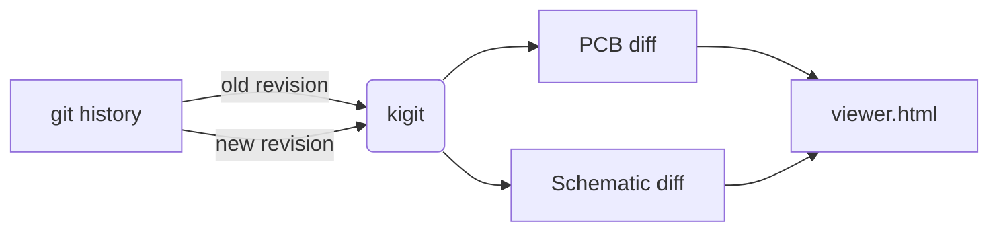

# Overview

Comparing two versions of a board takes three steps:

1. **Point kigit at a project:** run it inside a KiCad project folder, give the folder with `-C`, or open it in the GUI.
2. **Pick two revisions:** commits, branches, tags, `HEAD~3`, or `LOCAL` for your uncommitted changes.
3. **Read the page:** kigit writes one HTML page and opens it in your browser, with the PCB and the schematic as tabs.



## Minimal setup

```sh
cd ~/boards/my-board
kigit                      # HEAD vs the working tree (your uncommitted changes)
kigit HEAD~3               # HEAD~3 vs the working tree
kigit c46da63..HEAD        # two commits
```

The page is written to `.kigit/` next to the board (or wherever `-o FILE` says) and opened in your browser. The terminal also prints a summary of the most-changed nets and of the schematic changes.

## Which way to use it

| You want to... | Use |
| --- | --- |
| Browse the history and click two commits | [GUI](gui.md) |
| Compare from a script, a hook or CI | [Command Line](command-line.md) |
| Compare two copies of a project without git | [Without Git](../examples/without-git.md) |

## Colours

The same colours are used everywhere:

| Colour | Meaning |
| --- | --- |
| Green | Added in the newer revision |
| Red (dashed on the schematic) | Removed |
| Blue | Moved (same item, new place) |
| Amber | Schematic part whose value, footprint or connections changed |
| Grey | Unchanged |
