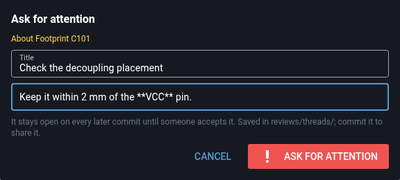
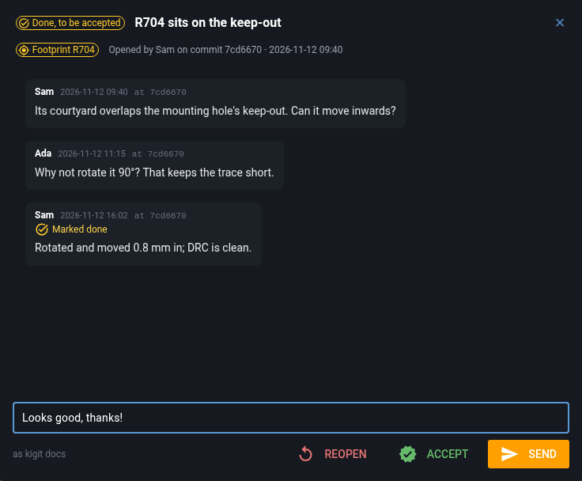
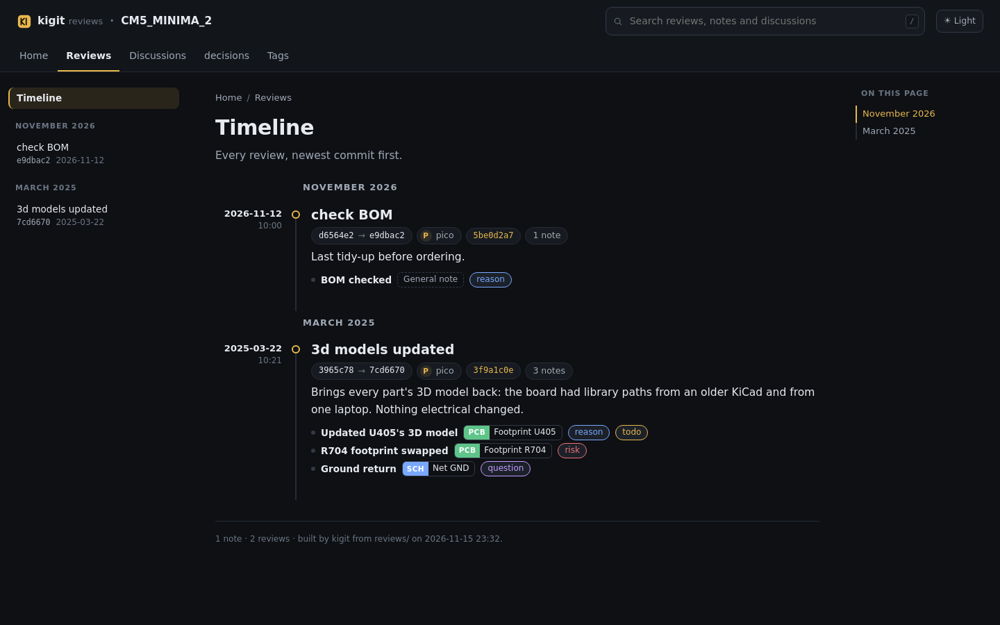
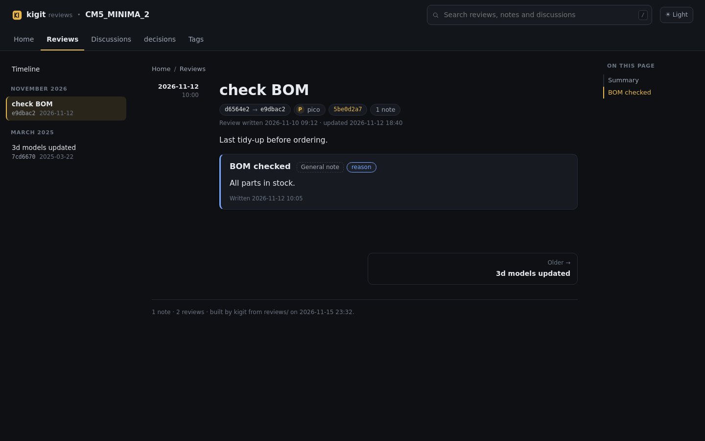
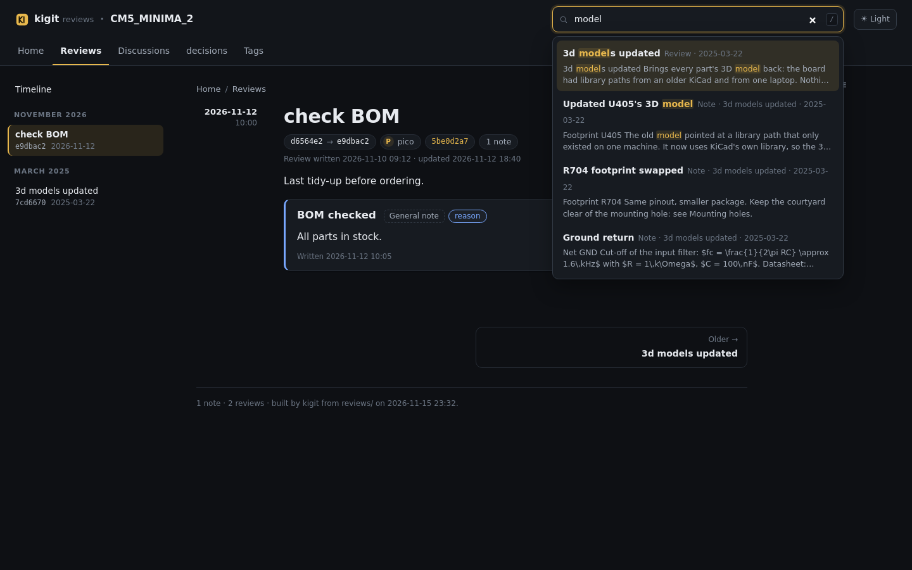
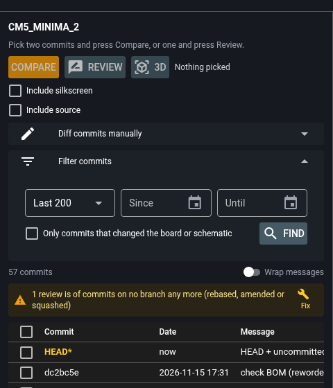
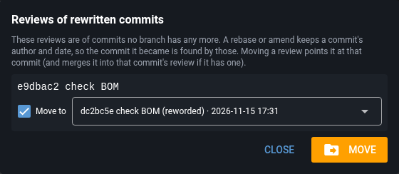

# Reviews

A review is your note on **why** a commit changed what it changed: the reasons behind a layout move, a part swap or a new net, written while you look at the diff, and kept with the project. Reviews are plain Markdown files, so they read fine on GitHub, in any editor, or in [Obsidian](https://obsidian.md).

## Review a commit

In the [GUI](gui.md), pick **one** commit and press **Review**. kigit compares it with the commit before it, and the review panel opens on the right. (Comparing a commit with its parent opens its review too.)

<figure markdown="span">
  
  <figcaption>The review panel: a summary, then notes. The footprint pinned in the viewer shows above the notes.</figcaption>
</figure>

- **Summary:** the commit as a whole.
- **Notes:** click a net, footprint, part or bus in the viewer to pin it, then press **+ Note**: the note points at it. Click the note's chip later to show it again in the viewer. Without anything pinned, the note is a general one.
- **Titles:** press :material-pencil: on a note and its title becomes a text box, like its text.
- **More than one thing, or the wrong one:** pin something else in the viewer, then use :material-map-marker-radius: next to the note's chips. **Add what's pinned** points the note at that too (a note can be about several parts, nets or footprints), **Replace with what's pinned** points it there instead, and **Make it a general note** drops them all. The ✕ on a chip takes just that one off.

    A note remembers the two commits it was pinned in, so it can still show a net or part that commit **deleted**: its chip turns red and says "removed".

- Each note shows when it was written and, if it was changed afterwards, when it was last edited.

Press **Write** (or ++ctrl+s++) to save. Until then the panel says "Unsaved changes"; if you switch to another commit first, your edits are kept as a draft for the session, and closing the page asks before throwing them away. Reviewed commits get a :material-comment-edit: mark in the commit list. Delete everything in a review (summary and notes) and Write, and its file is removed, mark and all.

### Writing notes

Text is Markdown: lists, code, tables, links. The text boxes (the summary, notes, and discussion messages) work like GitHub's comment box:

- **Write / Preview:** Preview shows it as it will look, math included.
- **Toolbar:** heading, **bold** (++ctrl+b++), *italic* (++ctrl+i++), quote, code, link, bulleted, numbered and task lists. Select text first to format it; press again to undo it. ++ctrl+z++ undoes too.
- **Files:** paste, drop, or click *Paste, drop, or click to add files* under the box. Pictures show in the text; any other file (a datasheet PDF, a scope capture, a log) becomes a link named after it. They're saved in `reviews/assets/`; PDFs and pictures open in the browser, other files download.
- **Links:** select the words to link and press :material-link: (or ++ctrl+k++), then give the address. Web addresses typed as they are (`https://...`) become links by themselves.
- **Math** is LaTeX, as in Obsidian: `$f_c = \frac{1}{2\pi RC}$` in a line, or `$$ ... $$` on lines of its own for a displayed equation. Prices like "$5 and $10" stay text; write `\$` for a dollar sign next to something that would look like math.
- **Tags:** pick them from the dropdown: the built-in ones (reason, todo, question, risk) and any tag used elsewhere in the project. Type a new one and press Enter to add it; it's saved as one lower-case word ("Needs Review" becomes `needs-review`), as Obsidian expects.

<figure markdown="span">
  { width="420" }
  <figcaption>Tags, coloured as on the Reviews page.</figcaption>
</figure>

## Where reviews are kept

One Markdown file per commit, in the `reviews/` folder next to the board:

```text
reviews/
  index.md        every review: ID, commit, date, author, subject (rebuilt on each Write)
  3f9a1c0e.md     one review; its ID is its file name
  assets/         added files: pictures, datasheets, ...
  threads/        discussions, one file each (see below)
  decisions/      your own notes, if you like (see below)
```

Each review gets an ID when first written, which is also its file name. Commit the folder with the project to keep the reviews with the design.

## Discussions: asking for attention

Notes explain a commit. When something in it **needs someone to act**, like a part that's too close to a hole or a value to double-check, open a discussion instead, as you would comment on a pull request. Anyone with the project can reply, mark it done, and accept it.

### Ask for attention

In a commit's review, pin what it's about in the viewer (or nothing, for the commit as a whole) and press **Request**. Give it a title and say what needs attention.

<figure markdown="span">
  { width="560" }
</figure>

### Talk it through

The :material-forum: **Discussions** button in the header lists them, with a count while any are active: red while one needs attention. Open one to see it as a chat, and reply: what you changed, or a question.

<figure markdown="span">
  { width="640" }
  <figcaption>Each message shows who wrote it, when, and which commit the project was at.</figcaption>
</figure>

A discussion moves through three states:

| State | Means | Buttons |
| --- | --- | --- |
| :material-alert-circle:{ style="color: #f07178" } **Needs attention** | Someone asked; nobody has dealt with it yet | **Mark as done** |
| :material-check-circle-outline:{ style="color: #e8b84d" } **Done, to be accepted** | It's been dealt with; the reviewer checks it | **Accept**, **Reopen** |
| :material-check-decagram:{ style="color: #5fc48a" } **Accepted** | Settled: the discussion is closed | **Reopen** |

Anything you type in the reply box goes along with the button you press ("Moved it 1 mm left", then **Mark as done**).

If you opened a discussion, :material-pencil: next to its title renames it (the chat keeps the old title), and :material-map-marker-radius: next to what it's about changes that, the same way as for notes: add what's pinned in the viewer, point it there instead, or make it about the commit in general; ✕ on a chip takes one off. The chat records the change ("Now about Footprint Y1, Part C5").

To change something you wrote, press :material-pencil: on your message, edit it, and **Save**. Only your own messages have the pencil (they're signed with your git name). The message stays where it was and shows *edited*. :material-delete: deletes one of your comments, after asking. Status changes (marked done, accepted, reopened) can't be deleted, since that would change the status; edit their text instead.

### Linking to a discussion or a review

:material-link: at the top of a discussion copies a link to it, `[its title](threads/<id>.md)`. Paste it into a review's summary or note, or into another discussion: it shows with a 💬, and clicking it opens the discussion. On the [Reviews page](#the-reviews-page) it goes to the discussion's page, and it's an ordinary link to the file on GitHub or in Obsidian.

Discussions listed in a review (and in the header's Discussions list) have their own :material-link: button too.

Reviews can be linked the same way: right-click a commit with a review in the commit list and choose **Copy review link** (`[commit message](<id>.md)`). Clicking it in a note or a discussion opens that review. The same menu has **Copy review file path** (the full path of its file) and **Copy commit hash**.

### Mentions

A discussion shows where it's linked from, in among its messages at the time it happened: "*Author B* mentioned this in the discussion *USB-C recessed*" (or *the review of ...*). Click it to go there. On the [Reviews page](#the-reviews-page), discussions and reviews have a **Mentioned in** list.

When someone else links to a discussion you opened or wrote in, the :material-bell: shows an **@** and a notification says where (it also pops up). Mentions that come with a `git pull` arrive the same way, within a few seconds. kigit keeps which ones you've seen in its [app folder](../app-folder.md), per project; the first time it sees a project, mentions already there count as seen.

Nothing is written into the linked discussion: mentions are worked out from the links themselves, so editing or deleting the message with the link takes the mention away too.

If a linked discussion or review is gone (deleted, or not pulled yet), kigit warns you: when you click the link, and when you open, write or send something that links to it. The warning also goes to the session log and the :material-bell: notifications. On the Reviews page the link shows greyed out.

### Jump to the commits

The commit hashes in a discussion are links (dotted underline). Click one to compare the commit the discussion was opened on with that commit, and the viewer shows what the discussion points at, pinned and zoomed to:

| Click | Compares |
| --- | --- |
| a message's **at** *hash* | where it was opened → that message's commit: what had changed by then |
| **Opened ... on commit** *hash* (or the first message's) | where it was opened → HEAD: where it stands now |

So if a part was deleted along the way, you still see it, marked **removed**, at the place it was, instead of searching the history for where it went.

### Across commits

A discussion belongs to the **project**, not just the commit it was opened on. Until it's accepted, it stays on:

- **every review**, under *Still open from other commits*, so the commit with the fix is where you mark it done;
- the **commit list**, as a flag on the commit it was opened on (red: needs attention, amber: done, green: accepted);
- the **Discussions** list and its count in the header.

### Sharing them

Each discussion is one Markdown file in `reviews/threads/`, written the moment you send a message: there's no Write step. Commit and push it like any other change; whoever pulls sees the discussion, and the GUI notices new or changed ones by itself (within a few seconds). Messages are signed with your git name (`git config user.name`).

Messages are only ever added at the end of the file, so two people replying to *different* discussions never conflict. If two of you reply to the same one at the same time, git shows a small conflict at its end: keep both messages.

The [Reviews page](#the-reviews-page) shows the discussions too, needing attention first.

## The Reviews page

**Reviews** in the header opens the project's reviews, notes and discussions in a new tab, laid out like a documentation site: one page each, with tabs, a sidebar and a search box.

<figure markdown="span">
  
  <figcaption>Home: counts, open discussions, the latest reviews and recently edited notes.</figcaption>
</figure>

- **Tabs** across the top: **Home**, **Reviews**, **Discussions**, then one tab for each folder you keep in `reviews/` (for example `decisions/` or `meetings/`), **Notes** for Markdown files directly in `reviews/`, and **Tags**.
- The **sidebar** on the left lists the pages in that tab (reviews by month, discussions by status, a folder's notes by subfolder). **On this page**, on the right, lists a page's notes or headings.
- **Search** (or press ++slash++) looks through every review, note in a review, note of your own and discussion as you type. Use ++arrow-up++ / ++arrow-down++ and ++enter++ to open a result.

<figure markdown="span">
  
  <figcaption>The Reviews tab opens on the timeline: every review, newest commit first, by month, with its summary and its notes' titles.</figcaption>
</figure>

- **Reviews** have a page each: the commit and author, the summary, then every note, marked with what it points at (PCB or schematic; red if it was removed) and coloured by its first tag. **Newer** and **Older** at the bottom step through the timeline.
- **Your own notes** are any other Markdown files in `reviews/` (design decisions, test results, ...), for example written in Obsidian. Frontmatter shows as properties, and `tags:` and `#tags` go to the Tags tab. `[[links]]` and `[text](other-note.md)` go to other notes, or to a review by its ID or its commit's message. Links to other files in `reviews/` (a datasheet PDF, say) open them, and `![[picture.png]]` embeds a picture.
- It follows your system's light or dark theme, or the Theme button's choice.

<figure markdown="span">
  
  <figcaption>A review's page: its notes, with On this page on the right.</figcaption>
</figure>

<figure markdown="span">
  
  <figcaption>Search shows matches as you type.</figcaption>
</figure>

## After a rebase, amend or squash

These replace commits with new ones (new hashes), so a review can be left pointing at a commit no branch has any more. Its file isn't touched, but the commit list no longer shows it as reviewed. A plain merge (or fast-forward) keeps the commits as they are, so nothing changes then.

When the GUI finds such reviews, it says so above the commit list:

<figure markdown="span">
  { width="480" }
</figure>

- **Fix** lists them. A rebase or amend keeps a commit's author and author date, so the commit it became is found by those and picked for you; press **Move** to point the review at it (notes pinned in that commit follow it too). If that commit has a review already, the two are merged.

    <figure markdown="span">
      { width="640" }
    </figure>

- A **squash** makes one new commit with a new date, so it can't be matched. Pick the squashed commit, press **Review**, then **Bring in reviews**: tick the reviews that went into it (those its message names, as `git merge --squash` and GitHub's "Squash and merge" do, are ticked already). Their summaries and notes are added to this review, and their files are removed when you press **Write**.

Git deletes replaced commits after a while (about a month), so a review you never move keeps its text but can no longer be matched automatically; Bring in still works.
