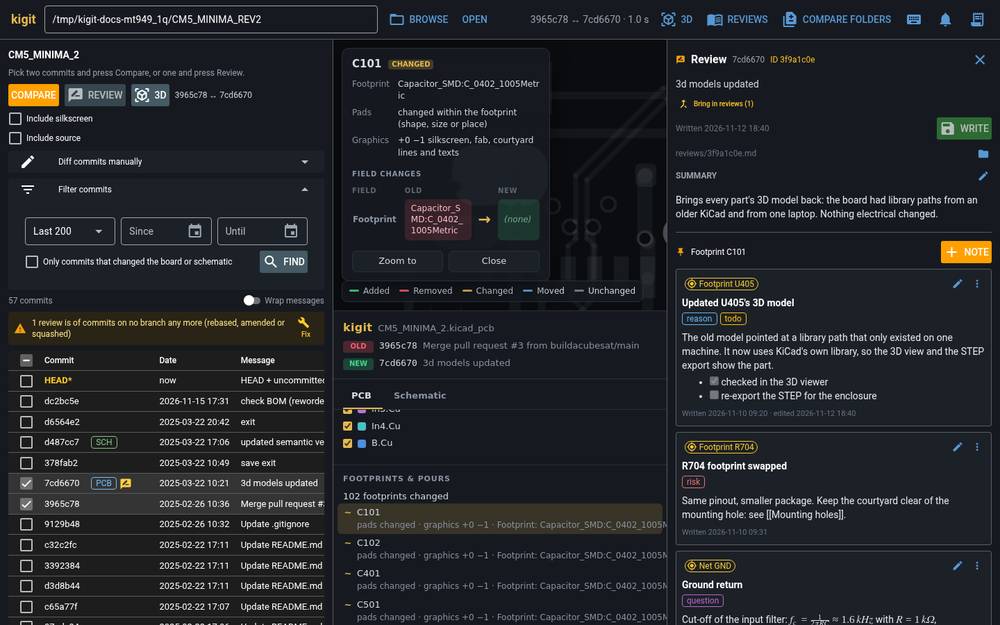
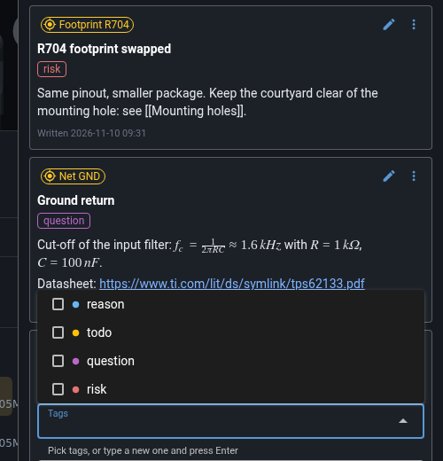
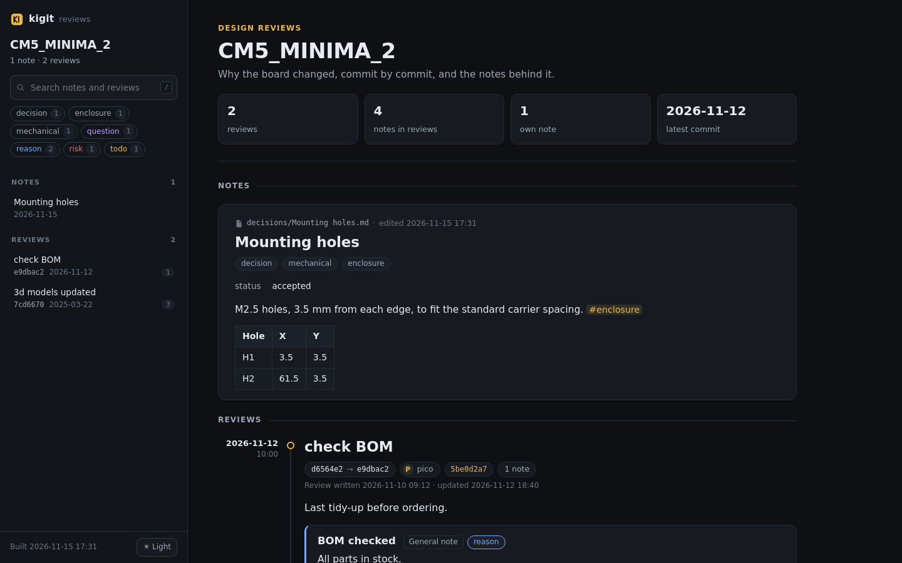
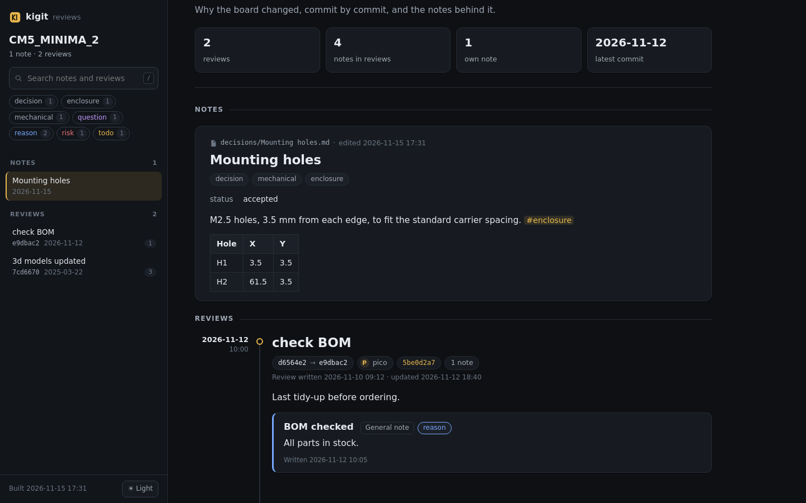

# Reviews

A review is your note on **why** a commit changed what it changed: the reasons behind a layout move, a part swap or a new net, written while you look at the diff, and kept with the project. Reviews are plain Markdown files, so they read fine on GitHub, in any editor, or in [Obsidian](https://obsidian.md).

## Review a commit

In the [GUI](gui.md), pick **one** commit and press **Review**. kigit compares it with the commit before it, and the review panel opens on the right. (Comparing a commit with its parent opens its review too.)

<figure markdown="span">
  
  <figcaption>The review panel: a summary, then notes. The footprint pinned in the viewer shows above the notes.</figcaption>
</figure>

- **Summary:** the commit as a whole.
- **Notes:** click a net, footprint, part or bus in the viewer to pin it, then press **+ Note**: the note points at it. Click the note's chip later to show it again in the viewer. Without anything pinned, the note is a general one.

    A note remembers the two commits it was pinned in, so it can still show a net or part that commit **deleted**: its chip turns red and says "removed".

- Each note shows when it was written and, if it was changed afterwards, when it was last edited.

Press **Write** (or ++ctrl+s++) to save. Until then the panel says "Unsaved changes"; if you switch to another commit first, your edits are kept as a draft for the session, and closing the page asks before throwing them away. Reviewed commits get a :material-comment-edit: mark in the commit list.

### Writing notes

Text is Markdown: lists, code, tables, links.

- **Pictures:** paste or drop an image into a note. It's saved in `reviews/assets/`.
- **Links:** select the words to link and press the :material-link: button in the text box (or ++ctrl+k++), then give the address. Web addresses typed as they are (`https://...`) become links by themselves.
- **Math** is LaTeX, as in Obsidian: `$f_c = \frac{1}{2\pi RC}$` in a line, or `$$ ... $$` on lines of its own for a displayed equation. Prices like "$5 and $10" stay text; write `\$` for a dollar sign next to something that would look like math.
- **Tags:** pick them from the dropdown: the built-in ones (reason, todo, question, risk) and any tag used elsewhere in the project. Type a new one and press Enter to add it; it's saved as one lower-case word ("Needs Review" becomes `needs-review`), as Obsidian expects.

<figure markdown="span">
  { width="420" }
  <figcaption>Tags, coloured as on the Reviews page.</figcaption>
</figure>

## Where reviews are kept

One Markdown file per commit, in the `reviews/` folder next to the board:

```text
reviews/
  index.md        every review: ID, commit, date, author, subject (rebuilt on each Write)
  3f9a1c0e.md     one review; its ID is its file name
  assets/         pasted pictures
  decisions/      your own notes, if you like (see below)
```

Each review gets an ID when first written, which is also its file name. Commit the folder with the project to keep the reviews with the design.

## The Reviews page

**Reviews** in the header opens all of the project's reviews and notes as one page, in a new tab.

<figure markdown="span">
  
  <figcaption>The Reviews page: a list to jump around, a search box and tag filters on the left.</figcaption>
</figure>

- **Reviews** are a timeline, newest commit first. Each note is marked with what it points at (PCB or schematic; red if it was removed) and coloured by its first tag.
- **Your own notes** are any other Markdown files in `reviews/` (design decisions, test results, ...), for example written in Obsidian: frontmatter shows as properties, `tags:` and `#tags` work with the filter, `[[links]]` and `[text](other-note.md)` jump to other notes or to a review (by its ID or its commit's message), links to other files in `reviews/` (a datasheet PDF, say) open them, and `![[picture.png]]` embeds a picture.
- ++slash++ jumps to the search; the `#` next to a heading copies a link to it. It follows your system's light or dark theme, or the Theme button's choice.
- The pictures are inside the page, so saving it from the browser keeps a complete copy.

<figure markdown="span">
  
  <figcaption>A review: its commit and author, the summary, then the notes with what they point at.</figcaption>
</figure>

## After a rebase, amend or squash

These replace commits with new ones (new hashes), so a review can be left pointing at a commit no branch has any more. Its file isn't touched, but the commit list no longer shows it as reviewed. A plain merge (or fast-forward) keeps the commits as they are, so nothing changes then.

When the GUI finds such reviews, it says so above the commit list:

<figure markdown="span">
  { width="480" }
</figure>

- **Fix** lists them. A rebase or amend keeps a commit's author and author date, so the commit it became is found by those and picked for you; press **Move** to point the review at it (notes pinned in that commit follow it too). If that commit has a review already, the two are merged.

    <figure markdown="span">
      { width="640" }
    </figure>

- A **squash** makes one new commit with a new date, so it can't be matched. Pick the squashed commit, press **Review**, then **Bring in reviews**: tick the reviews that went into it (those its message names, as `git merge --squash` and GitHub's "Squash and merge" do, are ticked already). Their summaries and notes are added to this review, and their files are removed when you press **Write**.

Git deletes replaced commits after a while (about a month), so a review you never move keeps its text but can no longer be matched automatically; Bring in still works.
