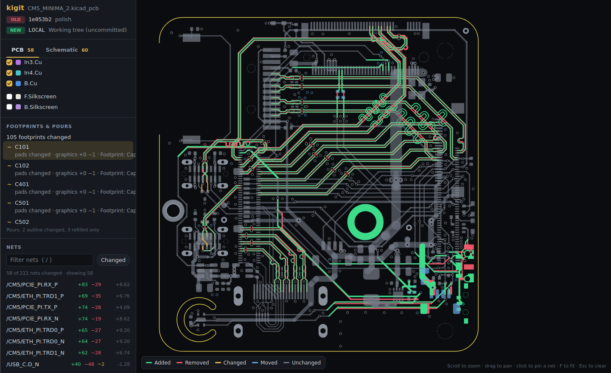

# Introduction

## What is kigit?

kigit is a visual diff for KiCad projects kept in git. Text diffs of `.kicad_pcb` and `.kicad_sch` files are thousands of lines of coordinates. kigit turns them into a picture of the board and schematic where every change is coloured, so you can review a layout change the way you'd review code.

It is a single command-line program (C++) plus an optional GUI. It runs on Windows and Linux.

It requires no internet connection, no logins, simply just an offline application that you can use to review your PCB changes.

### kigit CLI

<video autoplay loop muted controls width="100%">
  <source src="../blobs/demo-cli.mp4" type="video/mp4">
</video>

kigit CLI provides you the ability to simply perform every action via the command line interface without the need for any GUI. As demonstrated in the video above, all functionalities are accessible from the cli, and it will generate the .html file which you can specify its output directory. If not provided, by default, it will be stored in kigit hidden directory `.kigit/`.

### kigit GUI

<video autoplay loop muted controls width="100%">
  <source src="../blobs/demo-gui.mp4" type="video/mp4">
</video>

Similar to kigit CLI, kigit GUI simply provides the you with the ability to do everything via GUI. This is much more desirable as it may be more intuitive and easy to perform comparison where needed.

## Core concepts

### Two revisions

Every comparison is either between:

- an **old** and a **new** revision
- two commits (chosen by the unique hash found from the commits)
- a commit and your uncommitted changes (`LOCAL`)
- two folders when there's no git at all. "Added" always means added in the newer one.

### Matching

kigit matches items between the two revisions before colouring anything:

- **PCB:** tracks, arcs, vias and pads are matched first by KiCad's internal ID, then by geometry (same kind, net, layers and coordinates to 1 nm). An item with the same ID and the same copper at a new place is **moved**, not removed and re-added, so moving a footprint doesn't light up the whole board.
- **Schematic:** parts are matched by KiCad ID (then reference), so re-annotating shows as a rename. Nets are paired by label name, else by shared pins.

#### What a change looks like in the actual kicad source file

Each example shows the same item in the old and new `.kicad_pcb`, side by side, the way the [source panel](how-to-use/source-panel.md) shows it. Removed text is red, added text green, and the exact characters that changed are highlighted.

=== "Track edited"

    

CHANGEDowl_v1.kicad_pcb:1204 → :1204
<table class="kd-t"><colgroup><col class="ln"><col><col class="ln"><col></colgroup><tbody><tr><td class="ln">1204</td><td class="tx">    (segment</td><td class="ln">1204</td><td class="tx">    (segment</td></tr><tr><td class="ln">1205</td><td class="tx">        (start 121.5 84.25)</td><td class="ln">1205</td><td class="tx">        (start 121.5 84.25)</td></tr><tr><td class="ln del">1206</td><td class="tx del">        (end 135 84.25)</td><td class="ln ins">1206</td><td class="tx ins">        (end 135 90.75)</td></tr><tr><td class="ln del">1207</td><td class="tx del">        (width 0.25)</td><td class="ln ins">1207</td><td class="tx ins">        (width 0.4)</td></tr><tr><td class="ln">1208</td><td class="tx">        (layer "F.Cu")</td><td class="ln">1208</td><td class="tx">        (layer "F.Cu")</td></tr><tr><td class="ln">1209</td><td class="tx">        (net 12)</td><td class="ln">1209</td><td class="tx">        (net 12)</td></tr><tr><td class="ln">1210</td><td class="tx">        (uuid "8c1f3e7a-52b4-4d0e-9a51-3c2f6d1b7e40")</td><td class="ln">1210</td><td class="tx">        (uuid "8c1f3e7a-52b4-4d0e-9a51-3c2f6d1b7e40")</td></tr><tr><td class="ln">1211</td><td class="tx">    )</td><td class="ln">1211</td><td class="tx">    )</td></tr></tbody></table>
Same ID, but the copper itself changed (new end point and width). kigit draws the old track <b style="color:var(--kd-removed)">red</b> and the new one <b style="color:var(--kd-added)">green</b>, and the net's length change is updated.

=== "Footprint moved"

    

CHANGEDowl_v1.kicad_pcb:2310 → :2310
<table class="kd-t"><colgroup><col class="ln"><col><col class="ln"><col></colgroup><tbody><tr><td class="ln">2310</td><td class="tx">    (footprint "Resistor_SMD:R_0603_1608Metric"</td><td class="ln">2310</td><td class="tx">    (footprint "Resistor_SMD:R_0603_1608Metric"</td></tr><tr><td class="ln">2311</td><td class="tx">        (layer "F.Cu")</td><td class="ln">2311</td><td class="tx">        (layer "F.Cu")</td></tr><tr><td class="ln">2312</td><td class="tx">        (uuid "2b9d6c41-7f0a-4e83-b1d2-95c4a0e8f317")</td><td class="ln">2312</td><td class="tx">        (uuid "2b9d6c41-7f0a-4e83-b1d2-95c4a0e8f317")</td></tr><tr><td class="ln del">2313</td><td class="tx del">        (at 142.24 96.52 90)</td><td class="ln ins">2313</td><td class="tx ins">        (at 150.5 96.52 0)</td></tr><tr><td class="ln">2314</td><td class="tx">        (property "Reference" "R12"</td><td class="ln">2314</td><td class="tx">        (property "Reference" "R12"</td></tr><tr><td class="fold" colspan="4">⋯ 31 unchanged lines</td></tr><tr><td class="ln">2346</td><td class="tx">        (pad "1" smd roundrect</td><td class="ln">2346</td><td class="tx">        (pad "1" smd roundrect</td></tr><tr><td class="ln">2347</td><td class="tx">            (at -0.825 0 90)</td><td class="ln">2347</td><td class="tx">            (at -0.825 0 90)</td></tr><tr><td class="ln">2348</td><td class="tx">            (size 0.8 0.95)</td><td class="ln">2348</td><td class="tx">            (size 0.8 0.95)</td></tr><tr><td class="ln">2349</td><td class="tx">            (layers "F.Cu" "F.Paste" "F.Mask")</td><td class="ln">2349</td><td class="tx">            (layers "F.Cu" "F.Paste" "F.Mask")</td></tr></tbody></table>
Only the footprint's position and angle changed. Pad positions are stored relative to the footprint, so their text is the same, and the pads keep their IDs. kigit shows R12 and its pads as <b style="color:var(--kd-moved)">moved</b>, not removed and re-added.

=== "Via added"

    

ADDED— → owl_v1.kicad_pcb:1876
<table class="kd-t"><colgroup><col class="ln"><col><col class="ln"><col></colgroup><tbody><tr><td class="ln"></td><td class="tx fill"></td><td class="ln ins">1876</td><td class="tx ins">    (via</td></tr><tr><td class="ln"></td><td class="tx fill"></td><td class="ln ins">1877</td><td class="tx ins">        (at 128.27 101.6)</td></tr><tr><td class="ln"></td><td class="tx fill"></td><td class="ln ins">1878</td><td class="tx ins">        (size 0.6)</td></tr><tr><td class="ln"></td><td class="tx fill"></td><td class="ln ins">1879</td><td class="tx ins">        (drill 0.3)</td></tr><tr><td class="ln"></td><td class="tx fill"></td><td class="ln ins">1880</td><td class="tx ins">        (layers "F.Cu" "B.Cu")</td></tr><tr><td class="ln"></td><td class="tx fill"></td><td class="ln ins">1881</td><td class="tx ins">        (net 3)</td></tr><tr><td class="ln"></td><td class="tx fill"></td><td class="ln ins">1882</td><td class="tx ins">        (uuid "e41a07c9-3d5b-48f2-a6e0-7b19c25d8a64")</td></tr><tr><td class="ln"></td><td class="tx fill"></td><td class="ln ins">1883</td><td class="tx ins">    )</td></tr></tbody></table>
No item in the old file has this ID or this geometry, so the via is <b style="color:var(--kd-added)">added</b>: green, with nothing on the old side.

=== "Redrawn, same copper"

    

SAME COPPERowl_v1.kicad_pcb:1188 → :1188
<table class="kd-t"><colgroup><col class="ln"><col><col class="ln"><col></colgroup><tbody><tr><td class="ln">1188</td><td class="tx">    (segment</td><td class="ln">1188</td><td class="tx">    (segment</td></tr><tr><td class="ln">1189</td><td class="tx">        (start 98 72.5)</td><td class="ln">1189</td><td class="tx">        (start 98 72.5)</td></tr><tr><td class="ln">1190</td><td class="tx">        (end 110.25 72.5)</td><td class="ln">1190</td><td class="tx">        (end 110.25 72.5)</td></tr><tr><td class="ln">1191</td><td class="tx">        (width 0.25)</td><td class="ln">1191</td><td class="tx">        (width 0.25)</td></tr><tr><td class="ln">1192</td><td class="tx">        (layer "B.Cu")</td><td class="ln">1192</td><td class="tx">        (layer "B.Cu")</td></tr><tr><td class="ln">1193</td><td class="tx">        (net 7)</td><td class="ln">1193</td><td class="tx">        (net 7)</td></tr><tr><td class="ln del">1194</td><td class="tx del">        (uuid "5a0e93c2-18d4-4b6f-8e27-c3f1a9d04b85")</td><td class="ln ins">1194</td><td class="tx ins">        (uuid "f7c2d815-6e09-4a3b-b54d-0d8e2a61c9f3")</td></tr><tr><td class="ln">1195</td><td class="tx">    )</td><td class="ln">1195</td><td class="tx">    )</td></tr></tbody></table>
You deleted the track and drew it again in exactly the same place, so KiCad gave it a new ID. The ID pass finds no match, but the geometry pass does (same kind, net, layer and coordinates), so kigit shows it as <b>unchanged</b>. A plain text diff would call this a change.

### Types of changes

Schematic changes are split into three types:

| Type | What counts | Examples |
| --- | --- | --- |
| **Electrical** | Anything that changes the circuit | A part added or removed; its value, footprint or symbol changed; a pin moved to another net |
| **Fields only** | Text on a part that doesn't change the circuit | BOM fields like MPN, or the reference |
| **Cosmetic** | Layout changes with the same connections | Parts moved, wires redrawn, labels moved |

### One HTML file

The result is one self-contained HTML page with the PCB and schematic as tabs. It requires no server which you can open it, keep it, or attach it to a pull request.

## Further guidance
Follow the given order to see how kigit works from end-to-end:

- [Installing kigit](installation.md)
- [Using kigit Command Line (cli)](how-to-use/command-line.md)
- [Using kigit GUI](how-to-use/gui.md)
- [General kigit User Interface (UI) Overview](how-to-use/ui-overview.md)
- [Using PCB viewer](how-to-use/pcb-viewer.md)
- [Using schematic viewer](how-to-use/schematic-viewer.md)

## Limitations

- Custom-shaped pads are drawn as their anchor rectangle.
- Footprint graphics (courtyards, fab) aren't drawn; silkscreen is optional.
- Zones (copper pours) are drawn from the newer revision only and aren't diffed, because refilling a pour changes its shape every time.
- Old KiCad 5 boards are parsed but less tested.
- macOS isn't supported for now.
