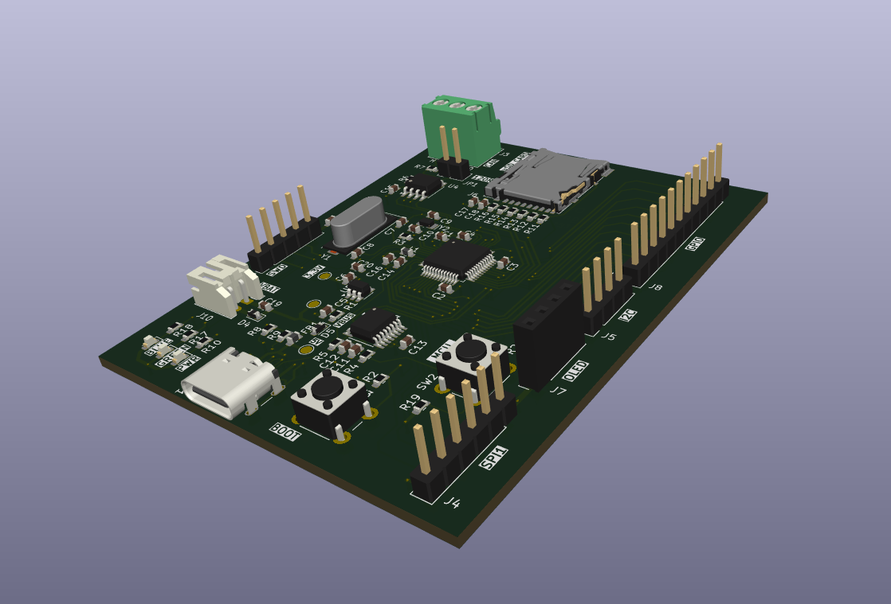
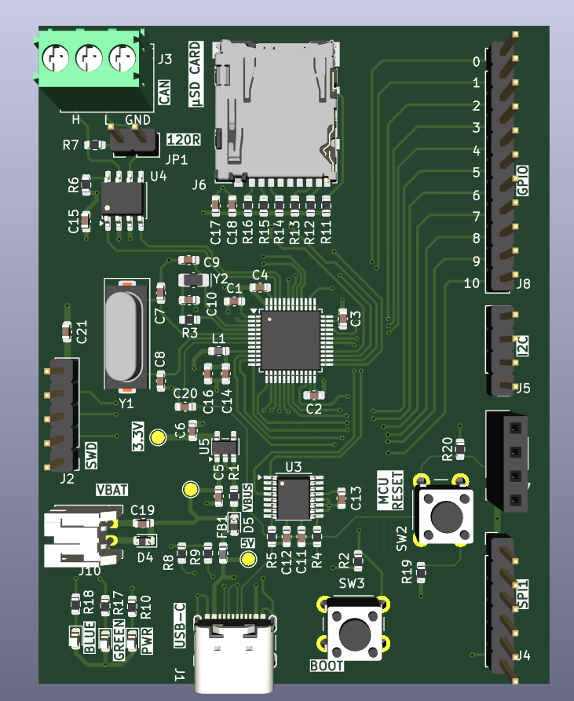
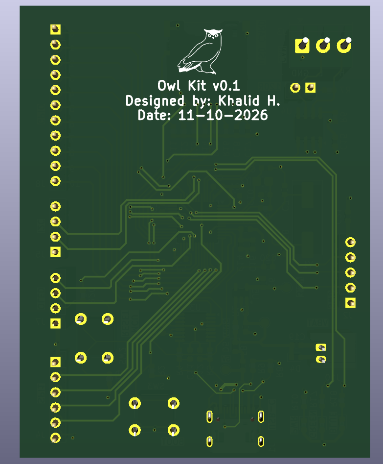

# Owl Kit Board

STM32F103 development board for my personal use case to learn more about how microcontroller works.

## Specifications
- Programming interface: USB 2.0 Full Speed (12Mbit/s)
- CAN
- MicroSD card
