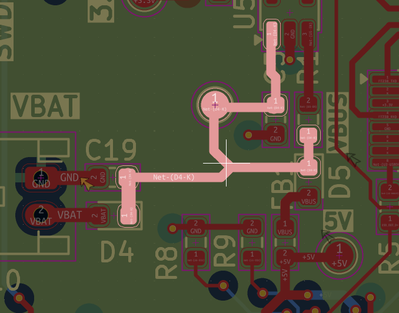
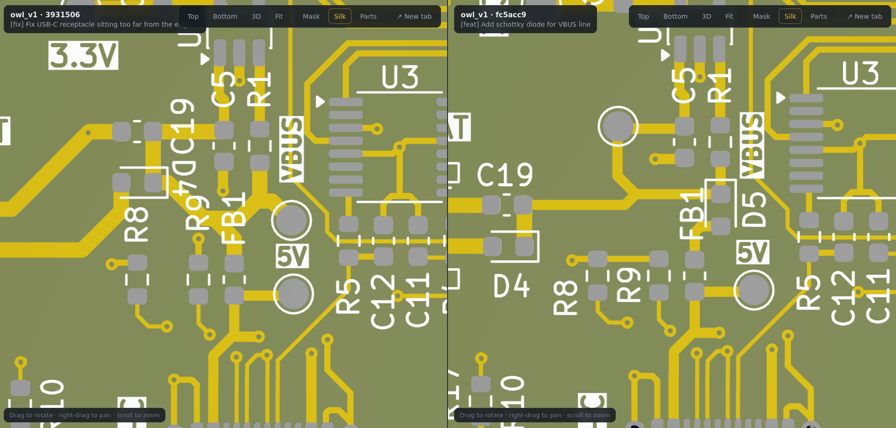

Adding schottky diode here due to concern raised.

Dicussion can be found here: [VBUS needs schottky diode](threads/193e6c7e.md)

## Note
<!-- kigit-note {"id": "faa6debb", "anchor": {"tab": "pcb", "kind": "net", "name": "VBUS", "seen": {"old": "3931506415be230e202581e9437e08e3be393fed", "new": "fc5acc994f71c85d27fac9443e937ba9c7462f24", "side": "new"}}, "tags": ["risk", "question"], "created": "2026-11-16 01:25", "edited": "2026-11-16 01:27"} -->

This feels wrong, I am not sure what the implications are with routing the VBUS to have to go through the test pad.

I had added a new schottky diode, and didnt have much space. I am being a bit lazy here by simply just re-arranging it this way.

